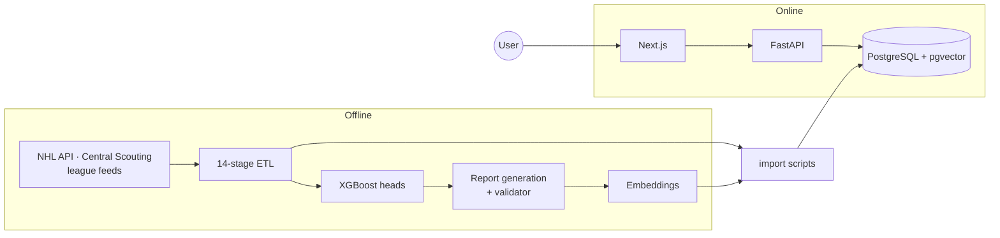

# PuckAI — engineering write-up

**Live site: [www.thepuckai.com](https://www.thepuckai.com)**

I built PuckAI as a hockey analytics site: NHL player profiles and tiers, pre-NHL
prospect projections, cross-era similar-player search, and a scouting chat that
answers from a report corpus instead of from the model's own memory. I design it,
build it, and run it solo.

This repo is the public write-up — architecture, the decisions I made and what they
cost, how I measured everything, and how the hard parts were debugged. **No product
code.** The platform itself lives in a private repo.

## Why this repo exists

The product code is private, so there is nothing to clone and run. What I can publish
is the engineering behind it: how the system is shaped and what the numbers actually
are.

Every number here is measured off the production system. Anything illustrative says
so.

---

## What it does

| Surface | What it is | In plain terms |
|---|---|---|
| **Player tiers** | 2,700 NHL skaters on a four-cohort ladder — Elite / Star / Core / Depth / Fringe **assigned** from career value, **predicted** for early-career players, **deferred** to the prospect board for rookies — plus 0–100 aspect scores per season | I grade NHL players on a five-rung ladder and score how they play across eight dimensions |
| **Prospect projection** | Three XGBoost heads over 55,455 pre-NHL players: P(NHL), P(GP ≥ 200 \| NHL), and a conditional tier with floor and ceiling | I predict whether a junior player makes the NHL, how long he lasts if he does, and what tier he lands in |
| **Similar players** | pgvector nearest-neighbour over 8-dimensional aspect vectors; cross-era for the time-on-ice era (1997-98+) | I find players who play similarly, even across different eras |
| **Scouting reports** | 7,643 generated reports, every number in them traced back to a pipeline value by a checker | I generate scouting write-ups and verify every fact against pipeline data |
| **PuckAI Scout** | Chat over that corpus: Postgres full-text + dense vectors, weighted RRF, neural rerank, scope routing, citations | I built a chat that searches my report library and cites its sources |

## How it fits together

I split the system into an offline half that computes everything and an online half
that serves it read-only. Batch jobs produce versioned artifacts; import scripts
load them into Postgres; the API and frontend read from there.

The offline path is batch and reproducible. The online path is stateless and
read-only for hockey data — the only writes on the request path are chat, feedback,
and saves. That split is the decision everything else hangs off; I walk through it
first in [architecture](docs/architecture/README.md).

## What's in here

| Document | What you'll find |
|---|---|
| [Architecture](docs/architecture/README.md) | How I split offline and online, what each component does, and how requests flow |
| [ETL pipeline](docs/etl/README.md) | The 14 stages, what each one guarantees, idempotency, and how it fails |
| [Retrieval](docs/retrieval/README.md) | How I built hybrid search, weighted RRF, scope routing, and the full result tables |
| [Report validator](docs/validation/README.md) | The checker I wrote to gate generated prose — six checks, no LLM |
| [How it was measured](docs/benchmarks/README.md) | Every number in this repo, and what it does not prove |
| [Label leakage in Stage 1](docs/bugs/label-leakage.md) | A missing column that meant two things — how I split coverage from rank |
| [Calibration by age band](docs/bugs/serving-time-calibration.md) | Why a global isotonic fit flattened every 17-year-old onto the base rate |
| [Decisions](docs/decisions/README.md) | Short records of choices I made — context, what else I tried, what it cost |

## Numbers

These are production measurements, not notebook benchmarks.

Retrieval — 77 labelled queries, depth 10. Full tables and the per-class breakdown
in [retrieval](docs/retrieval/README.md#results).

| Setup | NDCG@10 | MRR@10 | P@5 |
|---|---:|---:|---:|
| Keyword only | 0.488 | 0.555 | 0.140 |
| Vector only | 0.508 | 0.619 | 0.182 |
| Hybrid, unweighted RRF | 0.522 | 0.640 | 0.177 |
| Hybrid + rerank | 0.582 | 0.720 | 0.239 |
| **+ scope routing** | **0.682** | **0.764** | **0.330** |

Projection — held out, mean ± sd over three split seeds. Draft round alone gets
macro-F1 ≈ 0.18 (F) and ≈ 0.12 (D); that is the number to beat.

| Head | Metric | Value |
|---|---|---:|
| Stage 1 — P(NHL) | ROC-AUC / PR-AUC | 0.977 ± 0.001 / 0.849 ± 0.005 |
| Stage 1b — P(GP ≥ 200 \| NHL) | ROC-AUC | 0.699 ± 0.014 |
| Stage 2 — tier, F | exact / within-1 / macro-F1 | 0.375 / 0.767 / 0.379 |
| Stage 2 — tier, D | exact / within-1 / macro-F1 | 0.314 / 0.729 / 0.291 |

Report generation — 953 batches, 2026-07-31 to 2026-08-23.

| | |
|---|---:|
| Attempts | 7,670 |
| Passed the checker | 7,643 |
| Rejected, regenerated | 27 (0.35%) |
| Quarantined | 0 |

## Scale

| Table / artifact | Rows |
|---|---:|
| Pre-NHL development seasons | 859,556 |
| Prospect bios | 55,455 |
| Prospect predictions served | 54,933 |
| NHL season-trajectory rows | 38,899 |
| Scouting reports, embedded at 1024d | 7,643 |
| NHL tier assignments | 6,078 |
| Learned NHLe league factors | 1,484 |
| NHL skaters with full profiles | 2,700 |

## Stack

**Offline** — Python 3.12, pandas, XGBoost, scikit-learn; a staged ETL package with
a CLI runner (`--only` / `--skip`); pytest for schema and data-quality gates.
**Online** — FastAPI 0.136 + SQLAlchemy 2.0 + Pydantic 2.13 on serverless;
PostgreSQL 16 + pgvector (HNSW cosine) on Supabase; Next.js 16 / React 19 /
TypeScript / Tailwind 4. **AI** — Voyage embeddings (1024d) and `rerank-2.5-lite`;
the answer model is provider-pluggable. Local dev runs the whole stack on Docker
Compose.

---

**The core platform is a private repo. If you want a walkthrough or read access,
ask — happy to show how it works.**
