# PuckAI: engineering write-up

**Live site: [www.thepuckai.com](https://www.thepuckai.com)** (going offline TBD; the recordings below
stay up after it does)

[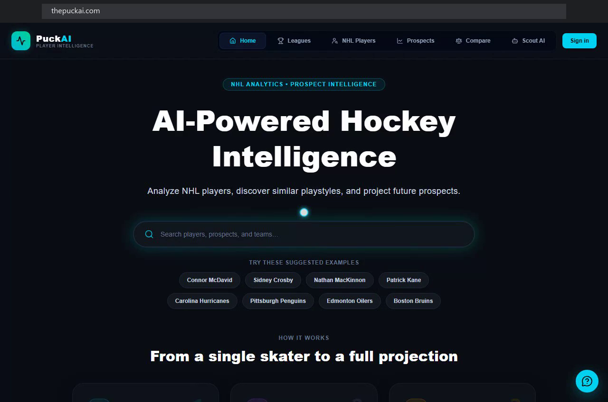](https://drive.google.com/file/d/1Ig18cQeeMEtRHCsdZT3fapmsLOHxO1zs/preview)

*A walkthrough of the live site (11 min 23 s), recorded in November 2026. Click the image to play it.*

PuckAI is a hockey analytics site I built and run on my own. It has NHL player profiles and tiers,
projections for pre-NHL prospects, a similar-player search that works across eras, and a scouting
chat that answers from a library of reports I generated and checked.

This repo is the write-up: how the system is put together, the decisions I made and what they
cost, how I measured things, and how I debugged the hard parts. There is no product code here. The
platform lives in a private repo.

## Why this repo exists

Since the code is private, there is nothing to clone and run. What I can share is the engineering:
how the pieces fit, and what the numbers actually are.

Every number in here was measured on the production system. If something is only illustrative, it
says so.

---

## What it does

| Surface | What it is | In plain terms |
|---|---|---|
| **Player tiers** | 2,700 NHL skaters on a five-rung ladder (Elite / Star / Core / Depth / Fringe). Tiers are assigned from career value, predicted for early-career players, and deferred to the prospect board for rookies. Each season also gets 0-100 scores on eight aspects. | I grade NHL players and score how they play across eight dimensions. |
| **Prospect projection** | Three XGBoost heads over 55,455 pre-NHL players: P(NHL), P(GP >= 200 given NHL), and a conditional tier with a floor and a ceiling. | I predict whether a junior player makes the NHL, how long he lasts, and where he lands. |
| **Similar players** | pgvector nearest-neighbour search over 8-dimensional aspect vectors, cross-era for the time-on-ice era (1997-98 on). | I find players who play alike, even across eras. |
| **Scouting reports** | 7,643 generated reports. A checker traces every number in them back to a pipeline value. | I generate scouting write-ups and verify every fact against my own data. |
| **PuckAI Scout** | Chat over that library: a planner, an entity linker, hybrid retrieval or computed comparables, adaptive *k*, and citations. | A chat that searches my reports and cites them. |
| **Scout Agent** | A LangGraph tool loop on top of Scout that can search the web (Tavily) and find highlight videos (YouTube Data API). | When the reports are too old to answer, the chat can look things up. |

## See it working

I recorded each part of the live site in November 2026, before taking it offline. Each GIF plays
here on its own; click it to open the full-quality video. The recordings were made with
Playwright at 1280×800. Recorded video has no browser frame, so I drew the address bar in
afterwards from the browser's navigation log. It shows the real URL at each moment.

### NHL player profile

A search for McDavid from the home page, then his whole profile, top to bottom: tier, the
eight-aspect radar, his season trajectory, the scouting report, the five nearest players from the
similarity search, what the prospect model projected for him before his first NHL game, and his
season-by-season league percentile.

[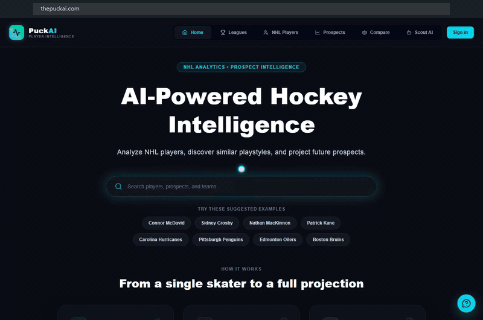](https://drive.google.com/file/d/1vkbuBwW43HlIj98OzdtZr03UtXlDFBCs/preview)

### Prospect projection

Three prospects, each found from the prospect board's search and read top to bottom: P(NHL),
expected tier with a floor and a ceiling, the outcome distribution, the scouting report, and the
league percentile by season.

Vaclav Nestrasil, a forward at UMass

[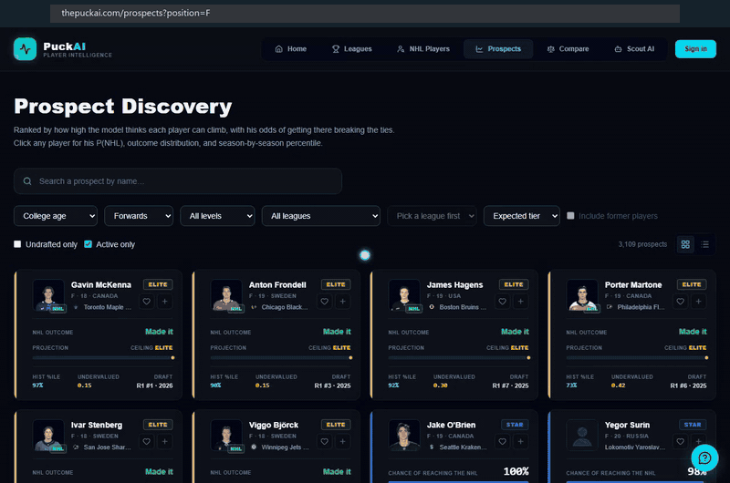](https://drive.google.com/file/d/1uTJBqi50kOiOevV72ThdmXUo_vmvUC54/preview)

Cole O'Hara, in the AHL

[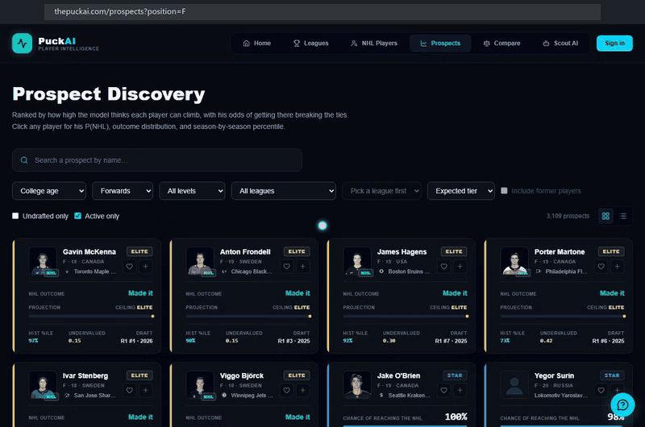](https://drive.google.com/file/d/1KkydwxKz4lju5jD6CdL6uBle97cgYIlX/preview)

Ryan Ufko, in the AHL

[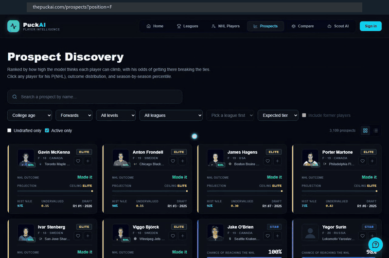](https://drive.google.com/file/d/1b2XOWqiVPqw90dBhjQMb42L6bPCijEph/preview)

Two prospects can also be compared head to head: each one's outcome distribution, first overall and
then conditional on reaching the NHL, with development curves aligned by age.

Cole O'Hara against Aiden Fink

[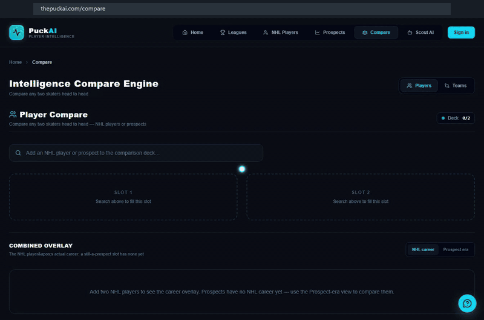](https://drive.google.com/file/d/1YyyCry13ZCYPWmyaUqY7x6DJwybMC02C/preview)

### Player comparison

Each pair is shown twice, in the NHL-career view and in the prospect-era view, then with the
outcome distribution conditional on reaching the NHL.

Crosby against McDavid

[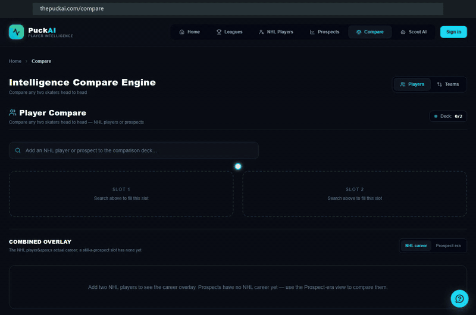](https://drive.google.com/file/d/1WN5XDrbacWIPdyTGh17w6HLCXJ8gxD8o/preview)

Crosby against Celebrini

[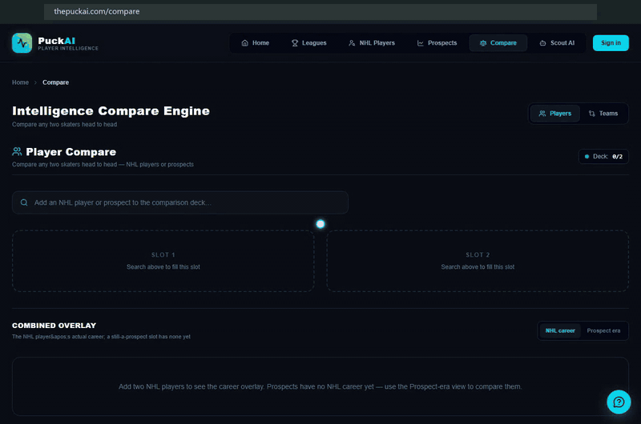](https://drive.google.com/file/d/1PB8oJOzzDDVBR4CWCaF6cRLcQuZUjFoE/preview)

Celebrini against McKenna

[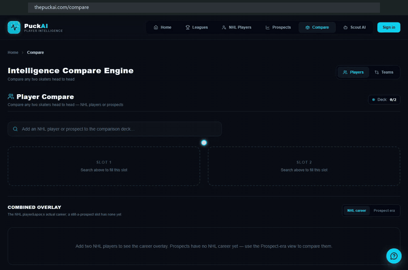](https://drive.google.com/file/d/1kcuM_LiwtpM-bhKsY55ZrMlMLhkL1Lz6/preview)

Makar against Schaefer

[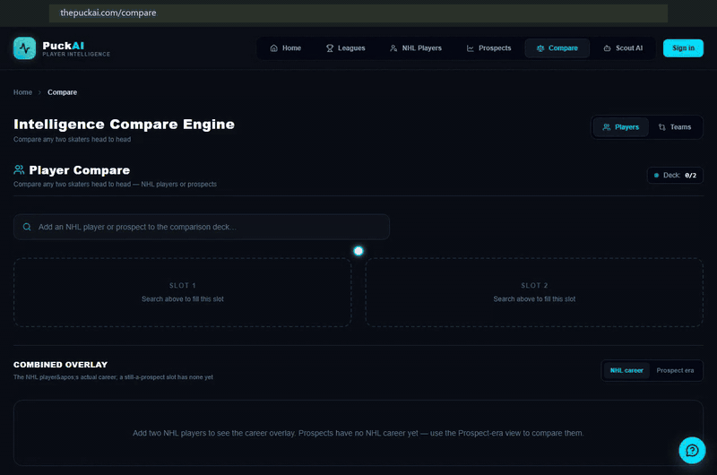](https://drive.google.com/file/d/1pJfqG03hYQ-ALrH9RJg3Xr7y-glAVz43/preview)

### Team comparison

Each pair is read down to the roster cards: tier breakdown, average aspect scores, team radars,
the head-to-head overlay, and the players by tier.

Vegas against Carolina

[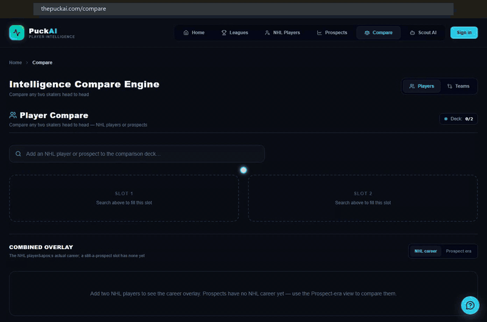](https://drive.google.com/file/d/1kkfWdHqWA2dtl3vsXPQPFBB2DgKZ6gpi/preview)

Colorado against Carolina

[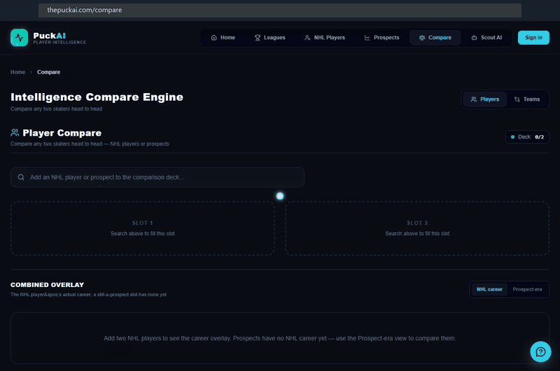](https://drive.google.com/file/d/1FQu6C6Hfa8VuYIhqHkZ0P5wHWb5RmEqb/preview)

The same comparison works for college teams.

UMass against Boston University

[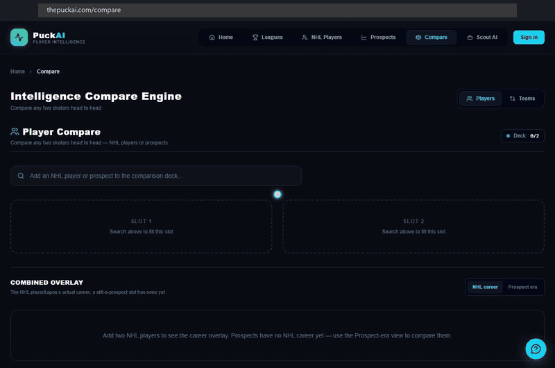](https://drive.google.com/file/d/1Nc_hHcQj3Pxd8GHaukqaTJi8l4oaKCzn/preview)

UMass against Boston College

[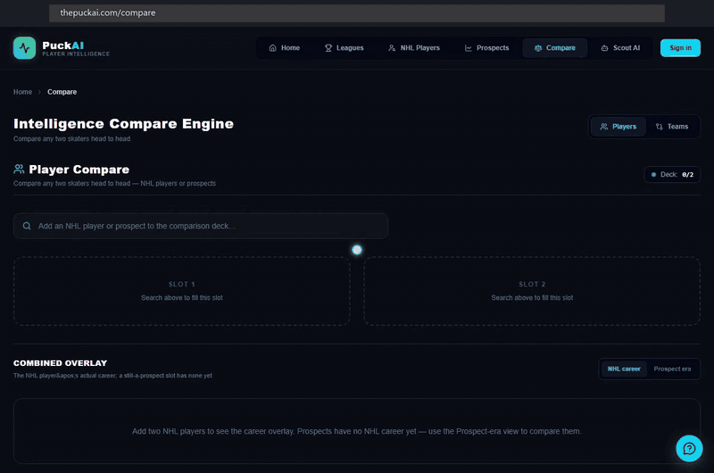](https://drive.google.com/file/d/1OwSInoF5kR4O3b1iCQb9dsQaHICRPp2v/preview)

### PuckAI Scout

A signed-out visitor clicks a sample question. This one is a **cached replay**: no model is called,
and the progress steps are compressed to at most 4 seconds. Live latency is in
[Numbers](#numbers).

[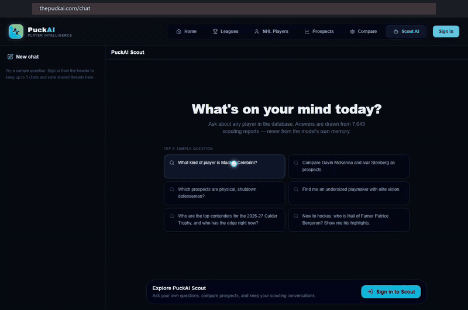](https://drive.google.com/file/d/1ZOIcq94UJQPUwvPh1PLQOKuyO2YvDVwV/preview)

Signed in, with a question typed and answered **live**. The wait on screen is the real wait; the only
cut is a half-second screen redraw.

[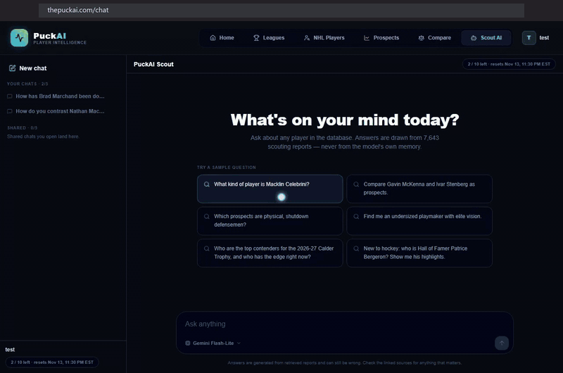](https://drive.google.com/file/d/1ph3ig1OM4cIiBDhWB2INFvyWEW13lhEF/preview)

### Scout Agent

The first question asks how Brad Marchand has been doing lately, which the reports can't answer. The
agent searches the web, reports his injury and expected return, and lists the sources it used. The
follow-up asks for highlights, which come back as video cards. Answered live; the only cut is a
half-second screen redraw.

[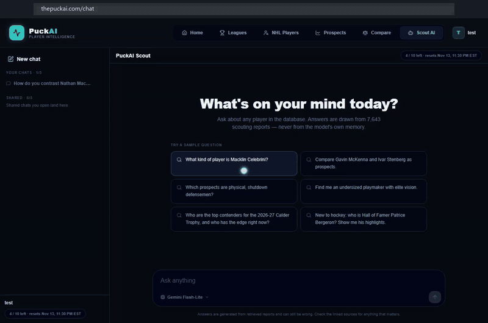](https://drive.google.com/file/d/1_r9WmMQ3ynl0oOmBrZR25P1y1p5N6WVB/preview)

## How it fits together

I split the system into an offline half that computes everything and an online half that serves it
read-only. Batch jobs produce versioned artifacts, import scripts load them into Postgres, and the
API and frontend read from there.

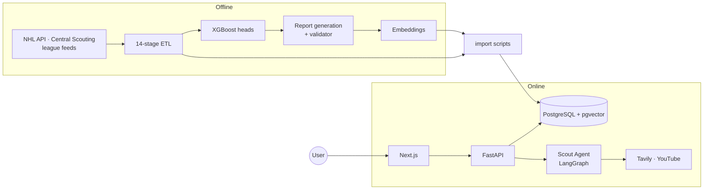

The offline path is batch and reproducible. The online path never writes hockey data. The only
writes on the request path are chat, feedback, saved lists, and the agent's tool cache. Most of the
other decisions follow from that split, so it is the first thing I cover in
[architecture](docs/architecture/README.md).

## What's in here

| Document | What you'll find |
|---|---|
| [Architecture](docs/architecture/README.md) | How I split offline and online, what each component does, and how a request flows |
| [ETL pipeline](docs/etl/README.md) | The 14 stages, what each one guarantees, idempotency, and how it fails |
| [Retrieval](docs/retrieval/README.md) | Hybrid search, the planner rewrite, the answer benchmark, and the ranking tables |
| [Scout Agent](docs/agent/README.md) | The tool loop, the fact check on web answers, video identity checks, quotas, MCP, tracing |
| [Report validator](docs/validation/README.md) | The checker that gates generated prose: six checks, no LLM |
| [Automation](docs/ci-cd/README.md) | What runs unattended, how a scheduled job is kept away from production, and two bugs only a real run found |
| [How it was measured](docs/benchmarks/README.md) | Where every number comes from, and what it does not prove |
| [Label leakage in Stage 1](docs/bugs/label-leakage.md) | A missing column that meant two things, and how I split coverage from rank |
| [Calibration by age band](docs/bugs/serving-time-calibration.md) | Why one global isotonic fit flattened every 17-year-old onto the base rate |
| [Players nobody asked about](docs/bugs/junk-entity-pins.md) | Seven separate causes behind one symptom, and why the harness had to exist first |
| [Decisions](docs/decisions/README.md) | Short records of choices I made: the context, what else I tried, what it cost |

## Numbers

**Retrieval ranking.** 78 labelled queries at depth 10, over the 7,643-report corpus. Full tables
are in [retrieval](docs/retrieval/README.md#ranking-results).

| Setup | NDCG@10 | MRR@10 | P@5 |
|---|---:|---:|---:|
| Keyword only | 0.482 | 0.554 | 0.146 |
| Vector only | 0.505 | 0.614 | 0.185 |
| Hybrid, unweighted RRF | 0.518 | 0.638 | 0.177 |
| Hybrid + rerank | 0.583 | 0.715 | 0.241 |
| **+ scope routing** | **0.686** | **0.762** | **0.333** |

**Answers.** The planner rewrite was measured first, on 119 questions (overall check pass 0.51 to
0.85). The table below is the second round: closing seven causes that let players nobody asked
about into the answer, on 132 questions across 13 intents, with both sides scored by the current
deterministic checks. Both tables are in [retrieval](docs/retrieval/README.md#answer-evaluation).

| | Before | After |
|---|---:|---:|
| Clean answers (no mechanical fault) | 0.667 | **0.795** |
| Answers that discussed a player nobody asked about | 9 | **0** |
| Names in the answer that trace to nothing | 20 | 7 |
| Blind pairwise judge on the weakest slice | | 7 wins, 6 ties, 0 losses |

One slice got worse: ambiguous names went from 0.64 to 0.55, and it is still open.

**Scout Agent.** 26 labelled questions run live against YouTube and Tavily. Details in
[Scout Agent](docs/agent/README.md#measured-results).

| | |
|---|---:|
| Picked the right tools | 26 / 26 |
| Searches nobody asked for | 0 |
| Database-only answers passed through unchanged | 1.00 |
| Whole turn, p50 / p95 | 5.1 s / 8.5 s |
| Web turn, before and after merging the answer | 15.4 s to 10.1 s |
| Wrong-player videos rejected (40 saved results) | 14 / 14 |

**Projection.** Held out, mean ± sd over three split seeds. Draft round alone gets macro-F1 of about
0.18 for forwards and 0.12 for defense, and that is the number to beat.

| Head | Metric | Value |
|---|---|---:|
| Stage 1: P(NHL) | ROC-AUC / PR-AUC | 0.977 ± 0.001 / 0.849 ± 0.005 |
| Stage 1b: P(GP >= 200 given NHL) | ROC-AUC | 0.699 ± 0.014 |
| Stage 2: tier, F | exact / within-1 / macro-F1 | 0.375 / 0.767 / 0.379 |
| Stage 2: tier, D | exact / within-1 / macro-F1 | 0.314 / 0.729 / 0.291 |

**Report generation.** 953 batches, 2026-07-31 to 2026-08-23.

| | |
|---|---:|
| Attempts | 7,670 |
| Passed the checker | 7,643 |
| Rejected and regenerated | 27 (0.35%) |
| Quarantined | 0 |

## Scale

| Table / artifact | Rows |
|---|---:|
| Pre-NHL development seasons | 859,556 |
| Prospect bios | 55,455 |
| Prospect predictions served | 54,933 |
| NHL season-trajectory rows | 38,899 |
| Scouting reports, embedded at 1024d | 7,643 |
| NHL tier assignments | 6,078 |
| Learned NHLe league factors | 1,484 |
| NHL skaters with full profiles | 2,700 |

## Stack

**Offline:** Python 3.12, pandas, XGBoost, scikit-learn, a staged ETL package with a CLI runner
(`--only` / `--skip`), and pytest for schema and data-quality gates.

**Automation:** GitHub Actions runs the test suites on every push and pull request, checks pinned
artifacts by hash, and refreshes in-season NHL stats every night. Vercel deploys on merge to `main`.

**Online:** FastAPI + SQLAlchemy 2.0 + Pydantic 2 on serverless, PostgreSQL 16 + pgvector (HNSW,
cosine) on Supabase, and Next.js 16 / React 19 / TypeScript / Tailwind 4. Local development runs
the whole stack on Docker Compose.

**AI:** Voyage embeddings (1024d) and `rerank-2.5-lite`, a provider-pluggable answer model,
LangGraph for the agent loop, Tavily and the YouTube Data API as tools, an MCP server for Claude
Desktop / Claude Code / Cursor, and OpenTelemetry tracing.

---

**The core platform is in a private repo. If you want a walkthrough or read access, ask and I'm
happy to show you how it works.**
