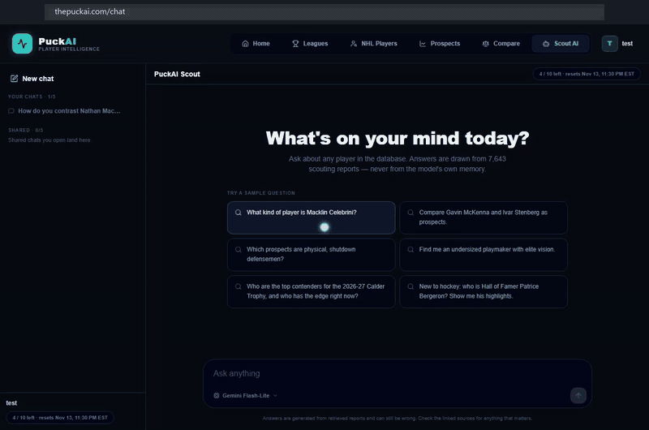
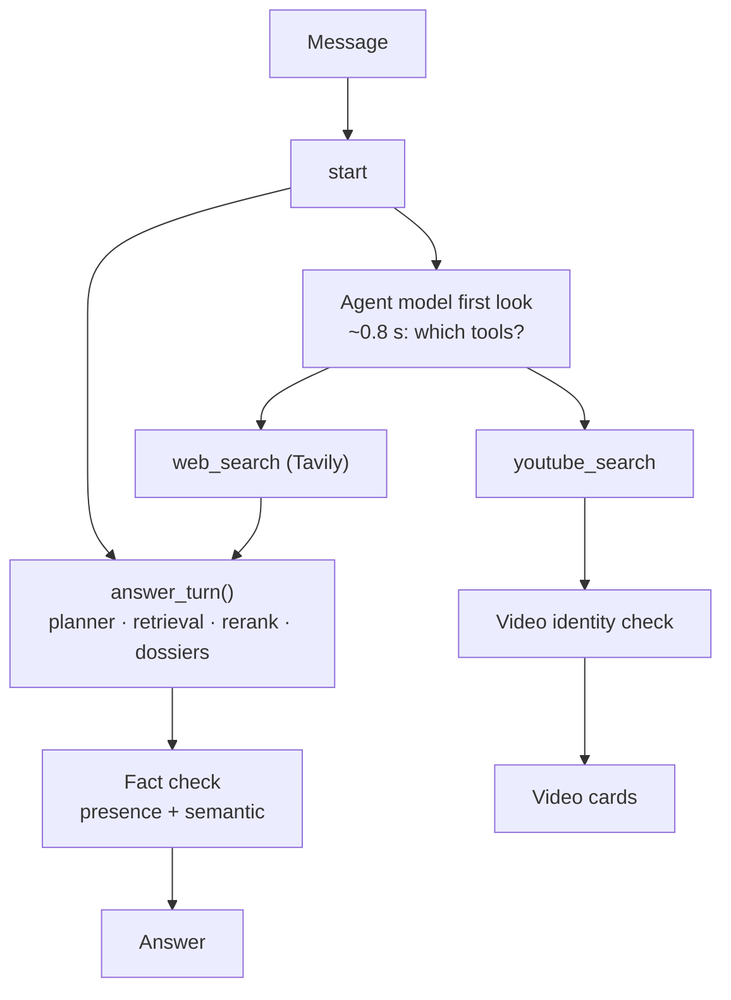

# Scout Agent: tools on top of the chat

PuckAI Scout answered only from 7,643 reports I had already generated. That meant it could not say
whether a player was injured this week, show his highlights, or talk about a 2026 draftee who is
newer than the library. In November 2026 I added two external tools, web search (Tavily) and
highlight videos (YouTube Data API v3), behind a LangGraph tool loop.

The agent wraps the existing chat. It does not replace it. The database answer still runs on every
turn, unchanged, and web results come in as extra evidence for that one answer. Every
web-informed answer is fact-checked, every video is checked against the player before it is shown,
and every external call runs under per-tool quotas with a shared cache in Postgres. It added about
2,900 lines of backend code and 112 tests.

Every number here comes from the agent eval (26 labelled questions) or from the saved runs named
next to it. How that eval works is in [how it was measured](../benchmarks/README.md).

*Two live turns on the production site: a question about recent form that goes to web search, then a
follow-up for highlights that comes back as video cards. Click to play.*

---

## Shape of a turn

The graph has no checkpointer. The transcript already lives in the chat tables, so there was
nothing for one to add. Each turn records its steps, tools, token counts, and guardrail trips on the
message row.

---

## Decisions, and the measurement behind each

### 1. The database answer is not a tool the model can skip

The existing answer path runs on every turn, at the same time as the agent model's first look. A
database question gets the same answer word for word, which keeps the 132-question answer
benchmark measuring what users actually see. The relevance gate still goes first, so an off-topic
question ends the turn before any search is spent. A turn that needs no tool adds no latency, and
one environment flag turns the whole agent off.

### 2. Web results feed one answer

The first version wrote the database answer and then glued a web paragraph under it. Asked "is Brad
Marchand still injured?", the top half said the reports had no injury information, directly above
a paragraph describing his knee injury. Neither model had seen both sources.

Now the web search runs after the relevance gate and before generation. Results go into the same
context under their own header, with rules for each topic: answer what was asked first, stay on the
asked topic, name the site, no raw URLs, and treat web text as untrusted. That took web turns from
**15.4 s to 10.1 s** and cut agent model calls from 2 to 1.

### 3. Freshness and sources

Five games into Connor Bedard's return, an answer still called it "not confirmed", working from a
July surgery report. The fixes:

- Tavily searches are limited to the last month, with one wider retry.
- Results are sorted newest first and labelled `official`, `major outlet`, or `other site`, with
  the publish date.
- Profile and social domains (LinkedIn, X, Reddit and similar) are excluded.
- "hockey" is appended to every query, in one place.
- Today's date goes into the agent prompt. Without it, the agent was searching "2024-25" during
  2026-27.
- Current-season numbers come from PuckAI's own nightly-updated database and win over any article.

### 4. Players newer than the library get searched

"Compare Gavin McKenna and Ivar Stenberg" used to answer that Stenberg was not covered. Now a named
player with no report gets a web search of his own. It has a separate cap so it cannot use up the
agent's own budget, and a fixed relevance bar: the full name as a phrase plus hockey context. If
nobody resolves, the turn writes a web-only answer.

### 5. Two layers of fact check on web answers

**Presence check (deterministic).** Every number and capitalised name has to trace to the
dossiers, the web results, or the question. This is the same code the offline answer eval scores
with. I moved it out of the eval harness, and the old and new versions agree on all 194 saved cases.
A flagged answer is regenerated once with the problem claims named. Anything still untraceable after
that is removed. (Deleting sentences straight away left answers that opened with "Additionally,".)
Small explainers for site names, abbreviations, and weekdays took false flags on live answers from
7 of 8 to 0 of 8.

**Semantic check (Gemini Flash-Lite, temperature 0).** This one catches a real number used for the
wrong stat, or two sources that disagree. I went through four designs on the same 8 live questions:

1. Given the dossiers, it judged this week's facts against last season's data.
2. `gpt-5-mini` was worse and 3 to 6 seconds slower.
3. With web-only input and a required verbatim quote, it found 3 real errors (a wrong goals/assists
   split, 25 points reported as 14, an injury timeline), but its delete pass also removed true
   facts.
4. Final design: the semantic check can only trigger the rewrite, and only the presence check can
   delete. All 8 answers came out correct with nothing true removed.

It costs about 0.7 s per web turn.

### 6. A video is shown only if it is that player

YouTube returns something for every query. "Will Smith highlights" returned the Dodgers catcher,
"Cole O'Hara" returned a volleyball reel, and "Jack Hughes" returned the Devils star when the Jack
Hughes in my library is a Kings prospect.

The rules run on folded text: hockey context, the name in the title (or surname plus full name in
the description), no other known player with that surname, and for shared names, the player's own
club. Namesakes come from the reports and from NHL rosters, both already in Postgres. When one
Elite-tier player carries a shared name, he owns it ("Elias Pettersson" is the Canucks centre). If
a video cannot be verified, it is dropped. It is never shown with a caveat.

On 40 saved results: **14 of 14 wrong-person videos rejected, and all 18 videos shown were the right
player.** In the live eval, 46 were shown and 24 rejected, and a manual audit of 18 shown videos
found no mistakes.

### 7. Quotas and a shared tool cache

The free tiers are ten times apart: YouTube allows 100 searches a day, Tavily 1,000 credits a
month. So budgets are per tool, per user window, and per turn, on the same usage ledger the chat
already uses. Running out does not return an error. The turn answers from the database and says
search is unavailable. Highlights nobody asked for can only spend quota above a reserve, so explicit
requests still work late in the day.

The cache keys highlight searches by player, not by query string. "Crosby", "Tell me about Sidney
Crosby." and "Show me Crosby highlights" are one row and one billed call. Videos are kept 7 days and
web results 1 hour. A stale video can be served for up to 30 days (the ceiling in YouTube's API
policies). News is never served stale.

### 8. Live progress in the browser

A streaming endpoint sends each stage as an NDJSON line. The progress listener is a context
variable that does nothing unless the streaming endpoint set it, so evals, MCP, and the old endpoint
are unaffected. Every stream ends in exactly one `result` or `error` line. On a cold 21-second turn,
the first event arrives at 0.7 s.

The sample questions on the site are curated in the admin panel. Their answers are generated by a
full agent turn and cached together with the recorded progress events, which the page replays in at
most 4 seconds. Visitors see the agent work without a model call, a quota hit, or a sign-in.

### 9. MCP server

`/mcp` exposes `scout_lookup` and the two search tools over MCP streamable HTTP, so Claude Desktop,
Claude Code, and Cursor can call them. It checks a bearer key in constant time and bills through the
same quotas. The server is built per request because Vercel functions do not run the ASGI lifespan
the SDK expects. I pinned `mcp==1.30.0`, since 2.x would have broken an `idna` pin and pulled the
OpenAI SDK up a major version.

### 10. Tracing

Turns are traced with manual OpenTelemetry spans using the GenAI conventions (model, input and
output tokens). Tracing only installs when an OTLP endpoint is configured. Question and answer text
are not recorded by default, and the user id is hashed. A serverless function freezes after it
responds, so the code flushes spans explicitly.

The same timings are stored on each message, so the admin trace page shows p50 and p95 latency,
per-stage medians, per-tool calls, cache hits and rejections, and guardrail counts straight from
SQL. No tracing vendor is needed to read them.

### 11. Hardening

- Model calls are abandoned after 12 seconds or at the turn deadline, and late results are thrown
  away. Model calls and tool calls run on separate thread pools, so an abandoned call cannot hold up
  a search.
- Tool output is cleaned, truncated, and fenced as untrusted. A tool result cannot close its own
  fence.
- Any URL in an answer that no tool returned is stripped.
- DNS connection errors get one retry. Nothing else is retried.

---

## Measured results

From the agent eval: 26 labelled questions, live YouTube and Tavily, Gemini as the agent model
(run `agent-v4-gemini-live`).

| Metric | Value |
|---|---|
| Picked the right tools | **1.00** (26 / 26) |
| Searches nobody asked for | **0** |
| Database-only answers passed through unchanged | **1.00** |
| Whole turn, p50 / p95 | **5.1 s / 8.5 s** |
| Agent decision, p50 | ~0.8 s, ~1.4k input tokens |
| Videos shown / rejected as unverifiable | 46 / 24 |

Other runs:

| Check | Result |
|---|---|
| Gemini vs `gpt-5-mini` as the agent (canned tools, 20 questions) | 1.00 vs 0.90. Both misses were compound questions. |
| Answer prompt v6 vs v7 (40 cases, same day and checks) | No regression; `lookup` 0.87 to 0.93 |
| Web turn latency, separate supplement vs merged answer | 15.4 s to 10.1 s |

An earlier 20-question live run measured p95 at 8.0 s. The 8.5 s above is the current 26-question
set.

**What these do not prove.** Tool choice is decided before any search result exists, so the
canned-tool runs measure it fairly. The 132-question answer benchmark does not exercise the web
rules, though, and 26 questions is a small set. The fact-check design was settled on 8 live
questions. That is enough to choose between designs, but not enough to quote an error rate.

---

## Related

- [Retrieval](../retrieval/README.md): the answer path the agent wraps
- [How it was measured](../benchmarks/README.md): how the eval sets are built
- [Report validator](../validation/README.md): where the presence check came from
