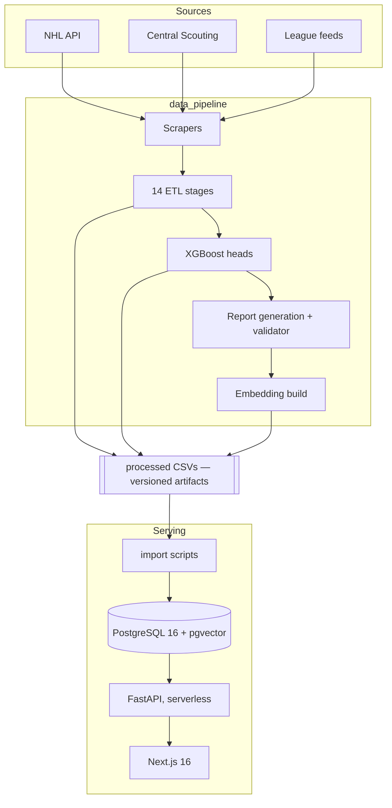
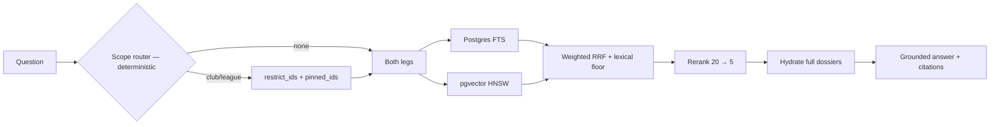

# Architecture

I split the system into two halves that meet at one database: a batch pipeline that
computes everything, and a stateless read API that serves it. Nearly every decision
downstream follows from keeping that seam clean.

---

## Hockey data is read-only online

I designed it so no request ever writes hockey data. Tiers, aspect scores,
projections, percentiles, reports — all computed offline, all loaded by import
scripts. The only online writes are user-owned: conversations, messages, feedback,
favourites, watchlists, and a `users` row mirrored just-in-time from a verified JWT.

What that buys me:

- **Reproducible.** A prediction is a row, not a live model call. The thing that
  produced it is a versioned CSV plus a metrics JSON.
- **Serverless-viable.** No model in the request path, so cold starts stay cheap
  and the API tolerates scaling to zero.
- **Cache-correct.** Derived caches — the search trie, the answer cache — have
  exactly one invalidation trigger: an import.
- **Debuggable.** A wrong number on a page traces to a stage output, never to a
  race between a request and a training job.

The cost: the board is only as fresh as the last pipeline run. That is why I built
an incremental in-season path next to the full rebuild — see
[ETL](../etl/README.md#in-season-updates).

---

## Components

| Component | Job | Notes |
|---|---|---|
| **Scrapers** | Raw season, bio, ranking, crest data | Parser per source; explicit alias maps, not fuzzy matching ([ADR 0006](../decisions/0006-explicit-alias-maps-over-fuzzy-matching.md)) |
| **ETL stages** | Clean → tier → project → serving artifacts | One package, one CLI, resumable per stage |
| **Model heads** | Stage 1 P(NHL), Stage 1b durability, Stage 2 tier | Grouped CV selects everything; test folds scored once |
| **Report generation** | Narrate a grounded context into prose | Deterministic validator gates every report |
| **Embedding build** | Voyage embeddings over the retrieval text | Resumable; a text-only mode works with no API key |
| **Import scripts** | CSV → Postgres | Full rebuild truncates and reloads; in-season upserts |
| **API** | Read hockey data; own chat and user state | Stateless apart from an in-process prefix trie |
| **Frontend** | Product surfaces | App Router, ~20 routes plus an admin area |

---

## Storage

I use one Postgres database. `pgvector` covers both vector workloads.

| Group | Tables | Shape |
|---|---|---|
| **NHL core** | `players`, `teams`, `player_tiers`, `season_trajectory`, `players_career_aspect` | Wide, denormalised for read; rebuilt per import |
| **Prospects** | `prospects`, `prospect_seasons`, league meta, team index | `prospects` is wide, with derived scores precomputed |
| **Scouting** | `scouting_reports` | Prose + retrieval text + `vector(1024)` on HNSW cosine, plus two persisted tsvector columns on GIN |
| **Chat** | `chat_conversations`, `chat_messages`, `answer_cache` | UUID conversation keys; message rows carry a spend ledger |
| **User** | `users`, favourites, watchlists, `ai_feedback` | The only online-write surface |

Two choices worth calling out.

**Conversation ids are UUIDs, not sequential.** I made threads shareable by unlisted
link. Sequential ids would make every thread in the system enumerable from one
shared URL.

**Two tsvector columns, not one** — `english` for prose, `simple` (unstemmed) for
names. Merging them is the obvious move and it fails in both directions
([ADR 0003](../decisions/0003-separate-name-and-prose-text-vectors.md)).

---

## Request paths

**A profile page** is a plain read. A few indexed selects, no computation. The one
thing it has to get right is *which kind of grade* a player carries: `tiered` for a
settled career, `provisional` for an early-NHL player whose tier was predicted or is
still deferred, `rookie` for a call-up the prospect board still owns. I serve the
badge straight off the cohort the pipeline assigned — the API never infers it from
games played, because that logic already exists in
[stage 2](../etl/README.md#the-four-cohorts) and two copies of it would drift.

**A similarity query** is a pgvector nearest-neighbour over 8-dimensional aspect
vectors. Scope matters. Career vectors are only comparable inside one scaling
track — modern 2005+ vs historical 1968–2004 — because careers span eras and
pre-1998 careers have only partial TOI, so career similarity is era-bounded.
Season-window vectors for 1997-98+ live in one shared space: a single min-max
scaling over both cohorts, real TOI. Within a season, a historical-track player and
a modern one compare head to head.

**A Scout question** is the only multi-stage path:

Rationale and numbers: [retrieval](../retrieval/README.md).

---

## Deployment

| Tier | Platform | Notes |
|---|---|---|
| Frontend | Vercel | Next.js 16, React 19, Tailwind 4 |
| API | Vercel serverless | FastAPI via an ASGI entrypoint; import scripts excluded from the bundle, so pandas never ships to production |
| Database | Supabase — PostgreSQL 16 + pgvector | |
| Auth | Supabase Auth, email + Google | API trusts verified JWTs, mirrors a `users` row just-in-time |
| Pipeline | Operator machine, batch | Pushes to production only behind an explicit flag |
| Local dev | Docker Compose | Full stack including Postgres; a dev overlay adds hot reload |

I deliberately do not run the pipeline on the serving platform. It is
long-running, network-heavy against sources with their own rate limits, and needs
far more memory than a request handler. Coupling it to the web tier would trade a
clean batch boundary for nothing.

---

## Caches

| Cache | Lives in | Invalidated by |
|---|---|---|
| Prefix trie for autocomplete | API process memory | Process start; a full import needs a restart or redeploy |
| Answer cache | `answer_cache` table | Truncated by the scouting import; also by a `PROMPT_VERSION` bump |
| Precomputed derived scores | Columns on `prospects` | Recomputed at import |

I key the answer cache **after** retrieval: question cosine ≥ 0.95 **and**
identical sorted doc ids **and** the same model. Question similarity alone would
serve a Jack Hughes answer to a Quinn Hughes question. Scope-routed turns are not
cached at all — the season window the router resolved is invisible to that key, so
caching them makes answers wrong rather than merely stale.

---

## Deliberately absent

- **No online training or inference for projections.** Predictions are artifacts.
- **No message queue.** Every async job is a resumable batch driven by a ledger
  file. A run that dies mid-flight resumes by re-reading the ledger.
- **No microservices.** One API, one database. The seam that matters is
  offline/online and it is already a process boundary.
- **No migration-managed schema for hockey tables.** They are rebuilt from CSVs;
  the schema lives with the import scripts.

---

## Related

- [ETL pipeline](../etl/README.md) — the 14 stages
- [Retrieval](../retrieval/README.md) — the Scout path and its evaluation
- [Validator](../validation/README.md) — how generated prose is gated
- [Decisions](../decisions/README.md)
