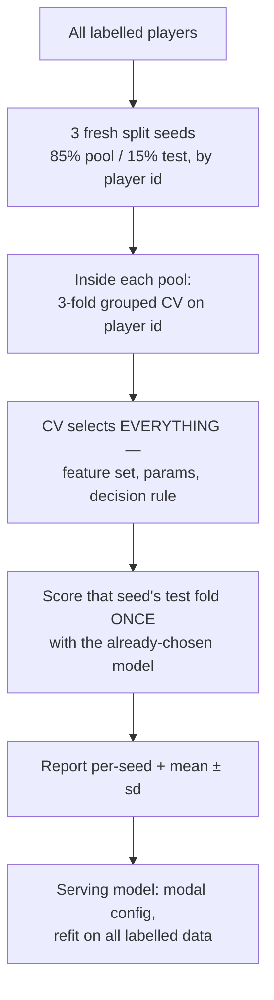

# How it was measured

Every number in this repo is something I measured on the real system — how I
produced it, and what it does not prove. Four separate regimes: retrieval ranking,
grounded answers, projection models, generated reports.

---

## The harness imports the served code

My retrieval and answer evals call the same functions the API calls. They do not
reimplement ranking, planning, or fusion, and they do not keep a parallel copy of
the served path.

That is not a convenience. A benchmark that reimplements the system measures the
reimplementation, and drifts silently the moment the two diverge — usually right
after a production fix, which is exactly when the numbers matter. The cost is some
flexibility in the harness.

---

## Retrieval

### The query set

77 labelled queries, five classes, depth 10, against a corpus snapshot of 7,406
reports.

| Class | n | Built from |
|---|---:|---|
| Name | 30 | Exact player identity |
| Archetype | 29 | Structured playstyle tags on player records |
| Team | 8 | Club + season membership in `prospect_seasons` |
| Multi_name | 6 | Combinations of exact identities |
| League | 4 | League + season membership |

### The rule that makes the labels mean anything

**No label is ever produced by keyword-matching the reports, and none by the
retriever under test.**

I build labels from *structured* facts that exist independently of the report text:

- A name query's relevant doc is the report for that player's canonical id.
- An archetype query's relevant set comes from playstyle tags on the player record
  — not from searching the prose for the archetype's words.
- Team and league queries derive their sets from season-level membership rows: who
  actually played for that club that season.

Build archetype labels by grepping the reports for "physical two-way defenceman"
and the lexical leg is measuring its own reflection — it scores near-perfectly by
construction. It scores 0.051 NDCG@10 on that class instead, which is a real
measurement of a real weakness.

### Metrics

| Metric | Definition | Why |
|---|---|---|
| Recall@K | Share of the relevant set inside the top K | Coverage |
| P@K | Share of the top K that is relevant | Precision of what the user sees |
| MRR@10 | Reciprocal rank of the first relevant doc | Is the top hit right |
| NDCG@10 | Discounted gain, normalised per query | Headline |

**NDCG@10 headlines because it normalises per query.** The others are
ceiling-bounded in ways that make cross-class comparison misleading:

- Recall@K cannot exceed K/|R|. A league query whose relevant set is a full NCAA
  season — ~500 docs — has a Recall@10 ceiling near 0.02.
- P@K has the opposite ceiling: a scope holding fewer than 5 docs cannot reach P@5
  of 1.000 however perfect the ranking. One club in the team set has 3 reports in
  the corpus, and that alone is the class's 0.950.

Both ceilings apply identically to every configuration, so comparisons between rows
stay valid even where the absolute value looks low.

### Configurations

Five, each a strict superset of the last: keyword only, vector only, hybrid
unweighted, hybrid + rerank, hybrid + rerank + scope routing. I report the
intermediates so the final number is interpretable — and that is how I caught the
finding that *unweighted* hybrid scores below vector alone on archetypes instead of
shipping it.

Results: [retrieval](../retrieval/README.md#ranking-results).

### Limits

- **77 queries is small.** A few thousandths of NDCG is not a result. The
  differences this eval justifies are large — 0.376 → 1.000 on team. I treated small
  ones as noise, which is why I reverted the header experiment on a 0.007 gain
  rather than shipping it.
- **Binary relevance.** No graded judgement of how well a player fits an archetype,
  so NDCG's gain function does less work than the name suggests.
- **The archetype class is bounded by tag quality.** It measures agreement with the
  structured playstyle tags, not with a scout.
- **Class sizes are uneven.** Four league queries cannot support a fine-grained
  conclusion, which is why I only quote the league result where the effect is
  enormous.

---

## Grounded answers

Ranking NDCG does not say whether the chat answered the question. The answer
harness runs the production decide-the-answer path over 119 questions across 12
intents and scores the resulting answer plus the context that produced it.

### The query set

| Intent | n | Intent | n |
|---|---:|---|---:|
| archetype | 20 | rank_team | 9 |
| lookup | 15 | style_comps | 8 |
| compare | 12 | constraint | 6 |
| stat_comps | 12 | off_topic | 6 |
| ambiguous_name | 11 | unknown_player | 6 |
| followup | 10 | rank_league | 4 |

Most rows are generated from the database. Follow-ups, off-topic turns, and absent
players are hand-written — SQL cannot invent those classes. Each row carries
include/exclude constraints, an expected *k*, a refusal flag, and SQL-pulled facts
a judge can check.

**The anti-circularity rule is the same as ranking.** No label comes from
keyword-matching the corpus or from asking the retriever under test. Distractors
come from name-token overlap on the corpus name column; constraint membership from
SQL predicates; ambiguity from NHL games played; archetypes from structured
playstyle tags.

### Two scoring layers

| Layer | Cost | What it answers |
|---|---|---|
| Deterministic checks | Free, every case | Player recall, namesake leakage, number/name faithfulness to that turn's context, refusal correctness, whether *k* fits |
| LLM judge | Batch ledger, pairwise after a rubric baseline | Preference between two concrete answers — absolute rubric scores drift across sessions |

The numeric faithfulness check is ported from the report validator, so a claim that
traces in generation traces in chat. The runner records the exact context string
sent to the model; rescoring recomputes summaries from saved cases without new
completions.

Baseline is the planner flag off — the pre-change system — under identical checks.
Headline: overall pass 0.51 → 0.85. Full per-slice table:
[retrieval](../retrieval/README.md#answer-evaluation).

### Limits

- **Mechanical checks measure faults, not usefulness.** The baseline scored 0.92 on
  `stat_comps` while returning namesake comps that were useless as answers. A drop
  to 0.75 after the rewrite is not evidence the new path is worse at the task.
- **Pairwise coverage is thin.** 5 of 119 judgements have been run — enough to prove
  the loop and to catch a goals/assists reversal both number checks missed, not a
  full preference sweep.
- **119 questions is still small** for rare intents. `rank_league` has four rows.

---

## Projection models

### Protocol

Four properties do the work:

**Splits are by player id, never by row.** A player contributes one row per age,
17–25. Splitting by row puts his age-18 and age-21 snapshots on opposite sides of
the split. That is direct leakage.

**CV drives all selection.** Feature set, hyperparameters, decision rule — all
chosen inside the pool. The test fold is scored exactly once, by a model already
fixed.

**Three seeds, reported with dispersion.** Every headline number is a mean ± sd over
three independent splits. A single split's number is not a result.

**The serving model is refit on everything.** Generalisation is established by the
seeds; the shipped model then uses all labelled data, in the modal config across
seeds, as a 3-model ensemble to cut variance.

### Numbers and baselines

| Head | Metric | Value | Baseline |
|---|---|---:|---|
| Stage 1 — P(NHL) | ROC-AUC | 0.977 ± 0.001 | — |
| Stage 1 — P(NHL) | PR-AUC | 0.849 ± 0.005 | Class prior. PR-AUC is reported because the class is imbalanced and ROC-AUC alone flatters it |
| Stage 1b — P(GP ≥ 200 \| NHL) | ROC-AUC | 0.699 ± 0.014 | — |
| Stage 2 — tier, F | exact / within-1 / macro-F1 | 0.375 / 0.767 / 0.379 | Draft-round macro-F1 ≈ 0.18 |
| Stage 2 — tier, D | exact / within-1 / macro-F1 | 0.314 / 0.729 / 0.291 | Draft-round macro-F1 ≈ 0.12 |

**The draft-round baseline is the honest comparison.** "How well can you predict a
prospect's tier knowing only where he was drafted?" is what the model has to beat to
be worth anything, and roughly doubling macro-F1 against it is the actual claim.
Exact-match of 0.375 on a five-class ordinal problem means little alone; against
that baseline, and next to a within-1 of 0.767, it means the model rarely misses by
more than a tier.

**Macro-F1 is 50% of the selection objective, deliberately.** I tried weighting exact
at 0.7 and it picked a rule that traded away Elite and Star to buy accuracy on Depth
and Fringe. The product exists to find upside; a metric that prices rare classes at
zero encodes the wrong goal however good it looks. I reverted.

### Censoring

Two rules keep unresolved outcomes out of the training signal:

- The durability head trains on **settled** players only. A player under 200 career
  GP who is still active has an unknown outcome, not a negative one — censored from
  training, still scored at serving.
- Tier labels for recent debutants that the GP floor would push downward are
  censored from the tier head. They would teach systematic under-projection of
  players whose careers have barely started.

### Limits

- **The label is historical.** Every positive reached the NHL under the scouting,
  development, and roster conditions of his era. Distribution shift over decades is
  real and only partly handled by era indexing.
- **Held-out metrics do not see leakage the split shares.** See
  [the label-leakage bug](../bugs/label-leakage.md) — aggregate metrics looked good
  throughout.
- **Aggregate discrimination hides subgroup collapse.** 0.977 ROC-AUC was compatible
  with near-zero discrimination inside the 17-year-old band. See
  [the calibration bug](../bugs/serving-time-calibration.md).
- **Tier labels are themselves derived**, from a career-value composite. Model error
  and labelling-scheme disagreement are not separable in these numbers.

---

## Generated reports

Gated by a deterministic checker rather than scored by a metric. Design:
[validation](../validation/README.md).

| | |
|---|---:|
| Attempts | 7,670 |
| Passed | 7,643 |
| Rejected, regenerated | 27 (0.35%) |
| Quarantined | 0 |
| Published first try | 99.6% |

953 batches, 2026-07-31 → 2026-08-23.

**What it does not prove.** The rejection rate is *post-hardening* — the prompt had
already been shaped by what earlier validator rounds caught, so 0.35% is not an
unguarded model's fabrication rate. And the number check is a presence check, not a
semantic one: a value appearing anywhere in the context passes anywhere in the
report. A 2% LLM spot-audit is my backstop for that class, and a sample is not a
guarantee.

---

## Reproducibility

| Regime | How | Notes |
|---|---|---|
| Retrieval ranking | Rebuild the query sets, run the harness | Deterministic given a corpus snapshot. The corpus grows between runs, so the snapshot count is recorded with the results |
| Grounded answers | Rebuild the answer query set, run the decide-the-answer path | Baseline is the planner flag off. Rescore from saved cases without new completions |
| Projection | Re-run the stage | Split seeds fixed and recorded; outputs include a metrics JSON next to the predictions |
| Generation | Re-run the ledger-driven batches | Generation is not deterministic. The gate is |

Each model version writes its own metrics artifact, so a version's claims can be
checked against the file that produced them rather than against a document.

---

## Related

- [Retrieval ranking and answer results](../retrieval/README.md)
- [Validator](../validation/README.md)
- [The two bugs](../bugs/) — where good metrics hid real problems
