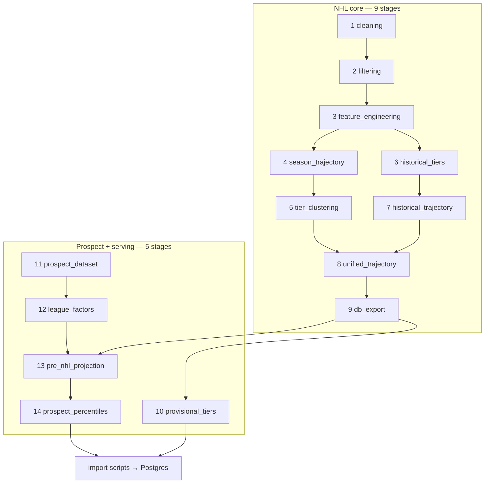

# The ETL pipeline

Everything the site serves comes out of one pipeline I built. Fourteen stages in a
fixed order: a **nine-stage NHL core** ending at the database export, then a
**five-stage extension** that predicts provisional tiers and builds the whole
prospect engine on top of the core's outputs.

I made stages addressable (`--only`) and skippable (`--skip`), so a change to the
tier model does not force a re-scrape and a re-clean.

---

## Stage graph

---

## The nine-stage core

| # | Stage | In | Out | Guarantees |
|---|---|---|---|---|
| 1 | `cleaning` | Raw NHL + league feed CSVs | Merged skater metadata, era splits | One identity per player across sources; era assignment is total |
| 2 | `filtering` | Merged metadata | Stable / fringe / rookie / provisional cohorts | Exactly one cohort per player, carved in a fixed order. See below |
| 3 | `feature_engineering` | Raw season stats | Per-game rates, z-scores, modelling tables | Rates are per-game, never season totals; z-scores name their reference population |
| 4 | `season_trajectory` | Features + cohort | Season and career aspect scores, 0–100 | Bounded; the scaling reference travels with the output |
| 5 | `tier_clustering` | Modelling features | Tiers 1–4 plus fringe | See below |
| 6 | `historical_tiers` | 1968–2004 cohort | Historical tiers | Same machinery as stage 5, scaled within era |
| 7 | `historical_trajectory` | Historical cohort | Historical aspects | As stage 4, within era |
| 8 | `unified_trajectory` | Both cohorts + a shared reference | Cross-era season-window vectors, 1997-98+ | One shared min-max scaling, real TOI |
| 9 | `db_export` | Everything processed | Final CSVs under `db/` | This directory is the pipeline's public interface. Nothing downstream reads a stage's intermediate output |

### The four cohorts

Stage 2 is where I decide *how* a player can be graded at all, and it is more
consequential than it looks. Not every NHL player has earned a tier, and pretending
otherwise is how a board fills up with confident nonsense about players who have
played nine games.

I carve four cohorts in this order — each one takes from what the previous left:

| Order | Cohort | Rule | How the player gets graded |
|---|---|---|---|
| 1 | **Fringe** | `total_gp < 40` **and** `max_gp_per_season < 25` **and** `seasons_over_6_gp ≤ 2` **and** `age > 26` | Assigned. Its own class — never a low Depth |
| 2 | **Rookie** | `seasons_over_6_gp < 2` **and** `max_gp_per_season ≤ 25` **and** `age ≤ 26` | **Not tiered.** Stays on the prospect board — his projection is still the best thing anyone has |
| 3 | **Provisional** | `25 < total_gp < 164` **and** `age ≤ 26` | **Predicted** from an early-career window (stage 10) |
| 4 | **Stable** | Everything left | **Assigned** from realised career value |

The order is the design. Age gates come *after* the production gates, so a
26-year-old with two games is a rookie and a 30-year-old with the same record is
fringe — the same stat line, different meanings, and only sequence separates them.

Two rules carry most of the weight:

**A provisional player who has left the NHL/AHL system is folded into stable.**
Gone to the KHL, or retired — the outcome is known, so there is nothing left to
predict. He gets tiered on career value like anyone else, where the 200-GP floor
keeps a short NHL stint out of the top tiers. Passing `in_system=None`, as the
historical cohort does, keeps everyone provisional, because "still in the system"
is meaningless for a player from 1974.

**A rookie is handed back to the prospect board rather than tiered.** A player with
one 20-game call-up has an NHL sample that says nothing, and an amateur record that
says a great deal. The product shows the projection, badged `Rookie — on the
prospect board`, instead of inventing an NHL tier. Provisional players below the
60-GP threshold that stage 10 requires are badged `Provisional — early NHL, not yet
tiered` for the same reason.

That handoff is the point of the cohort split: **the prospect engine owns a player
until his NHL sample is worth more than his amateur record, and not one game
sooner.** A tier is a claim, and I only make one where I have the evidence.

### What a tier is

This is how I grade the **stable** cohort — the players with enough career to
measure. It is not a clustering of rate stats. That is the naive version and it
produces a board full of high-rate players who never played.

- **Elite and Star** — the top 30% — come off a **career-value** composite:
  sample-size-shrunk rates combined with total production. Careers under a GP floor
  are excluded from the top tiers outright. Elite is the top 10%, award-calibrated,
  symmetric across F and D.
- **Core vs Depth splits on durability, not rate.** A regular — averaging ≥ 40
  GP/season — is Core; a part-timer at the same rate is Depth. This is the single
  distinction that most changes how the board reads, and rate-only clustering gets
  it wrong every time.
- **Fringe** is its own class, not the bottom of the scale.

### Why stage 8 exists

Career aspect vectors are only comparable inside one scaling track. Careers span
eras, and pre-1998 careers have no reliable TOI at all, so career-scope similarity
stays era-bounded (the historical track also applies a ±10-year contemporaries
filter).

Season windows are different. The NHL has tracked per-game TOI reliably from
1997-98, so `unified_trajectory` rebuilds the trailing 3-season window vectors for
those seasons in **one** space across both cohorts: per-season z-scores against a
common all-players reference, real TOI rather than a neutralised stand-in, one
min-max scaling over the pooled rows. A 2009-10 window on the historical track and
a 2009-10 window on the modern track then share coordinates.

`db_export` stitches by season-start year — unified vectors from 1997 on,
TOI-neutralised historical vectors before that. The API's season-scope query needs
no era filter at all; it already compares inside a calendar season, and the unified
scaling is what makes that honest.

---

## The five-stage extension

| # | Stage | Job |
|---|---|---|
| 10 | `provisional_tiers` | Predicts tiers for NHL players with a limited sample, so they serve alongside stable and fringe |
| 11 | `prospect_dataset` | Harmonises both classes into one dev-stats table; drops tournaments; canonicalises era-renamed leagues; per-season age; leakage-safe awards; CSS coverage |
| 12 | `league_factors` | Learns NHLe translation factors across leagues |
| 13 | `pre_nhl_projection` | Age-snapshot features, three heads, serving predictions + a metrics JSON |
| 14 | `prospect_percentiles` | Peer percentiles, a byte-offset season index, and the board's league/team facets |

**Stage 10 — provisional tiers.** The core ETL only *assigns* tiers to players with
a stable sample. Stage 10 *predicts* them for limited-sample players, from
early-career windows that accumulate whole seasons to 60 / 82 / 120 / 160 GP,
scored on the same tiering features (per-season z-scores against the stable
population, clipped at −1.0). One XGBoost model per position. Under 60 NHL GP is
deferred rather than guessed at, and those players keep the `Provisional` badge
until they cross it. Aspect scores are min-max scaled against the stable reference
so they share the radar scale with everyone else — a predicted tier and an assigned
one are directly comparable on the same radar, which is the only reason it is safe
to show them on the same page.

**Stage 12 — learned NHLe.** Cross-league PPG is not comparable, and the published
NHLe constants are stale and coarse. I learn them here: paired same-season and
adjacent-season PPG ratios for players who appear in two leagues, corrected for age
growth, solved as one weighted-least-squares graph anchored at the NHL, then
era-indexed and region-shrunk. 1,484 league-era factors out.

**Stage 13 — the heads.** A hurdle, deliberately, rather than one multi-class model:

| Head | Task | Notes |
|---|---|---|
| Stage 1 | P(NHL) | Monotone XGB ensemble over 3 seeds, age-band isotonic calibration |
| Stage 1b | P(GP ≥ 200 \| NHL) | Same shape; trained on settled players only, still-active under 200 GP censored |
| Stage 2 | Conditional tier given reach | Per position, monotone constraints, ordinal model + a selected decision rule |

---

## Invariants

These are the properties I built the pipeline to hold. Both bugs written up in this
repo are cases where one of them broke silently.

**Age-snapshot semantics.** Every feature row is computed *as of age a*, a ∈ 17…25.
A training positive cut at his pre-debut window and a live prospect cut at his
current age mean the same thing: career shape up to age a. Anything that lets
time-to-debut inform a snapshot is leakage.

**Missingness means one thing.** A column whose absent values carry two meanings
gets learned as a label proxy. That is [the label-leakage bug](../bugs/label-leakage.md).

**Training and serving windows differ on purpose, and explicitly.** Post-debut
minor-league seasons are *kept* in the percentile population and in serving
snapshots — a called-up prospect's AHL year has to count — and *held out* of that
player's own training features by an explicit flag. Which scrape file a row arrived
in must never decide whether a season exists.

**Facts live in flags; probabilities stay honest.** P(NHL) is the model's pre-NHL
probability for everyone, graduates included. Forcing it to 1.0 after a debut
destroys the retro view the feature exists for. Graduation is a flag.

**Season labels are normalised at the edge.** Every source writes its own format —
an end-year query param here, a start-year folder there, `15/16` somewhere else.
Each scraper normalises to `YYYY-YY`; the consuming stage asserts it.

---

## Idempotency and failure modes

| Property | How |
|---|---|
| Re-running a stage is safe | Stages write whole artifacts, never append in place; the raw-CSV merge has its own idempotency test |
| A partial run resumes | `--skip` / `--only`; stage outputs are the resume points |
| A failed scrape cannot corrupt state | Scrapes write raw storage; the ETL only reads it |
| Import is atomic per rebuild | Full rebuild truncates and reloads; the in-season path upserts on declared keys |
| A new league or club is never silently dropped | Every joining script prints the names that did not join. Add an alias — do not loosen the match |

What actually goes wrong:

- **A source changes its season labelling.** Caught by the stage assertion, loudly.
- **A club relocates.** Feeds that dedupe by club *name* silently drop every name
  but the first for a franchise that has moved. Keying on the franchise id fixes
  it, and it is why I walk every season instead of the current one.
- **A feed returns a placeholder instead of nothing.** One source hands back a
  "no photo" URL rather than a null, so a URL built from an id instead of read from
  the feed 404s about half the time.
- **A source starts blocking scripted clients.** The answer is a second independent
  source for the same field, not a more aggressive client. Coverage gaps are
  catalogued with the reason, including the sources known to be unreachable.

---

## Tests

I split tests by whether they need pipeline artifacts on disk.

| Class | Checks | Needs artifacts |
|---|---|---|
| `TestSchema` | Every required column present in every output | Yes |
| `TestDataQuality` | No null PKs, aspect scores 0–100, GP > 0 | Yes |
| `TestNoDuplicates` | No duplicate PK in any table | Yes |
| `TestCrossTableConsistency` | Every child-table id exists in its parent | Yes |
| `TestMergeIdempotency` | The raw-CSV merge is safe to run twice | No |
| `TestDbUpsertConfig` | Upsert column lists exclude PKs, right count | No |
| `TestSeasonScraperHelpers` | Season string format, required column set | No |

Artifact-dependent tests skip with a clear message rather than failing when the ETL
has not been run, so the logic-only suite stays fast and always runnable.

---

## In-season updates

A full rebuild is the wrong tool for a nightly refresh: cleaning, filtering, and
tier clustering are stable within a season, and re-running them is slow and churns
tier assignments for no reason.

I built an update path that re-runs only the data-dependent stages, then **upserts**
instead of truncating. It can skip the scrape entirely and re-run the ETL over
existing raw data, target one season, and push to production only behind an explicit
flag. Nothing reaches production as a side effect of a local run.

---

## Related

- [Architecture](../architecture/README.md) — where the pipeline sits
- [Bug: a label in disguise](../bugs/label-leakage.md)
- [Bug: calibrated, and useless](../bugs/serving-time-calibration.md)
- [How it was measured](../benchmarks/README.md)
