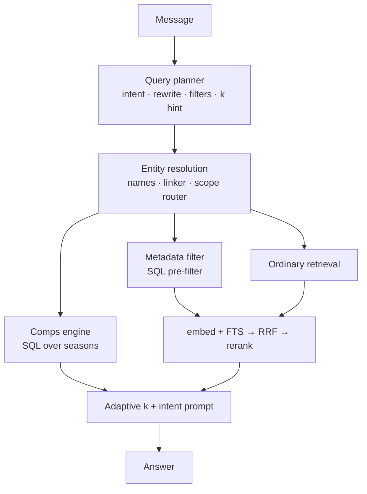

# Retrieval and grounded answers

PuckAI Scout answers from a corpus of 7,643 grounded scouting reports I generated,
never from the model's own memory. This doc covers two layers that used to be one
pipeline: how I find and rank documents, and how a later rewrite sits a planner,
entity linker, and computed comparables in front of those retrievers so the answer
path can do things text search structurally cannot.

Every number below comes from the harnesses in
[how it was measured](../benchmarks/README.md). Both harnesses call the production
functions, so the benchmark cannot drift away from the served path.

---

## Before and after

The old path had no stage between the user's sentence and the retrievers. Raw text
went verbatim to the embedding, the tsquery, the reranker, and the prompt.
`FINAL_K` was hardcoded to 5.

I inserted four stages in front, and replaced the constant *k* with an adaptive one:

Failure on the planner always returns a plan byte-identical to the old behaviour.
A flag turns the planner off and reproduces it exactly, which is how I scored the
baseline below.

---

## The four stages

### 1. Query planner

One structured-output call on a small model chosen independently of whichever model
writes the answer. It produces intent, a pronoun-resolved rewrite, named players,
club/league scope, measurable filters, and a *k* hint.

It never invents an id. It proposes name strings; the corpus's own index resolves
them. A hallucinated name matches nothing rather than the wrong player.

### 2. Entity linking

The resolver used to return nothing for any name matching several players, so
"Crosby, McDavid, and Mackinnon" pinned two and silently dropped the third. It now
reports ambiguous spans, and the linker settles them from NHL games played,
report-embedding similarity to the players who did resolve, and draft-cohort
proximity. All three signals are already in the database, so there is no extra API call.

Scope routing still sits here as the club/league resolver it always was; it hands
`restrict_ids` / `pinned_ids` into the legs below.

### 3. Comparables computed, not retrieved

Text search cannot answer "who produced like X". The report that most resembles a
report about Cole O'Hara is a report about Ryan O'Hara: same surname token, wrong
task.

The comparison lives in `prospect_seasons`: anchor on the player's best pre-NHL
season by NHLe, candidates within an age window in the same league or tier group,
ranked by z-scored distance. Style comps reuse the anchor's own stored vector.
That path bypasses embed/FTS entirely and feeds adaptive *k* directly.

### 4. Metadata pre-filter

Height, weight, draft round, nation, PPG are columns, not semantics. The planner
extracts them; this stage turns them into `restrict_ids` (the same lever scope
routing already used) before hybrid retrieval runs.

### Supporting changes on the answer path

- Chat orchestration split into a pure decide-the-answer step (writes nothing, bills
  nobody) and a thin wrapper for quota, persistence, and response.
- Adaptive *k* replaces the constant 5.
- Entity masking on the lexical leg so pinned names do not drown the rest of the
  query.
- Intent-conditioned prompt; `PROMPT_VERSION` and intent added to the answer-cache
  key.
- Per-turn retrieval telemetry stored as JSONB for later diagnosis.
- Later: exact bare-surname pins, whole-player planner names, first-turn rewrite
  discipline, neighbour fill for open questions, and labelled dossiers
  (`PROMPT_VERSION` → 5). Write-up:
  [players nobody asked about](../bugs/junk-entity-pins.md).

The unit tests covering planner, linker, comps, metadata filter, and the
decide-the-answer path brought the suite from 125 to 181.

---

## Why hybrid, and why both legs stay load-bearing

I tried dense-only and lexical-only first. They fail in opposite directions, and not
subtly:

| Class | Example | Dense | Lexical |
|---|---|---|---|
| Archetype | "physical two-way D with a heavy shot" | Wins: shared meaning, almost no shared keywords | Near-total failure |
| Name | "Macklin Celebrini" | Smears across similar-sounding prospects | Wins: exact match is the whole task |

Measured: on archetypes, keyword-only NDCG@10 is 0.051 against vector-only's 0.139.
On names, keyword-only is a clean 1.000 against vector-only's 0.954.

That is why I report eval metrics per class. A single average lets a configuration
that destroys one class hide behind another, and during development one nearly did.

### Weighted RRF, not score blending

Cosine distance and `ts_rank_cd` live on unrelated scales, so blending them
numerically means inventing a conversion. RRF fuses on **rank** and sidesteps it.

Equal weights actively hurt. Dense beats lexical ~2–3× on archetypes while both
legs already saturate name recall, so 50/50 dragged hybrid *below* vector alone.
Production is dense 2.0, lexical 1.0, flat across a 2.0-5.0 sweep, which is the
shape you want: the result is not balanced on a knife edge.

### The lexical floor

Weighting dense at 2.0 created its own bug. On a query naming two players, the
second name could get pushed past the rerank pool boundary and never reach the
cross-encoder. I added a floor that reserves pool slots for the top lexical hits.
multi_name Recall@5: 0.833 → 1.000.

---

## Small-to-big: retrieve short, generate long

My retrieval unit is a compact field: a one-line header plus the report prose.
Generation unit is the full dossier: bio, projection, report, season tables,
percentiles, assembled at request time for the final *k* only.

**Stat tables are not embedded.** Every player's table looks alike, so embedding
them pulls vectors toward a shared box-score centroid, inflates rerank cost, and
would force a re-embed after every prospect re-import. The tables reach the model
through hydration, where they cost nothing at ranking time.

### The header experiment, reverted

I enlarged the embedded header (physical frame plus a three-season summary) and
measured it:

| Metric | Before | After |
|---|---:|---:|
| NDCG@10, hybrid + rerank | 0.624 | 0.631 |
| MRR@10 | flat | flat |
| Recall@5 / P@5 | — | fractionally down |
| Attribute probes | — | worse |

Old and new vectors sat ~0.0145 cosine apart on average: the prose, ~1k chars,
dominated. I reverted it. **Do not retry.**

**Numeric and club constraints are a metadata-filter problem, not an embedding
problem.** Trying to make an embedding carry a hard constraint is a category error.
It is what motivated scope routing, and later the planner's filter extraction.

---

## Scope routing

"Top prospects at UMass over the last three seasons" was close to unanswerable by
text search, structurally. Club lives only in the header, about 5% of the doc.
`report_tsv` indexes the prose alone. And the header carries `latest_team`, where
the player is *now*, not where he was that season. The old behaviour returned
UMass-**Lowell** players and alumni who had left years earlier.

I built a deterministic router, with **no LLM for the route itself**, that resolves
club or league from a DB-built alias index, hands `restrict_ids` into both SQL
legs, and takes `pinned_ids` from the *same* percentile ranking the team pages use,
so chat and board never disagree. It now sits inside entity resolution, after the
planner has proposed scope strings.

Four safeguards, each from an observed failure:

- **Tiered aliases**: an exact club name beats a place-name fragment.
- **Directory leagues only**: peewee clubs were claiming words like "center".
- **A group or superlative cue required** ("top", "best", "who are") so a
  head-to-head comparison that names a league is not over-scoped into a ranking.
- **Ambiguity → no route**, falling back to ordinary hybrid. A wrong scope is far
  worse than no scope.

Routed turns are **not cached**: the season window is invisible to the answer cache
key, so caching them returns confidently wrong answers.

Measured: team NDCG@10 0.415 → **1.000**, league 0.307 → **1.000**, with name,
multi_name, and archetype unchanged to three decimals.

---

## Lexical details that mattered

**Two configurations, not one.** `report_tsv` on `english` for prose, `name_tsv` on
`simple`, unstemmed, for names. Merging fails both ways: one config stems surnames
(`Louis` → `loui`), and OR-ing both into one tsquery explodes nodes: about 952 ms vs
134 ms. Names score separately with `FTS_NAME_BOOST=3.0`.
See [ADR 0003](../decisions/0003-separate-name-and-prose-text-vectors.md).

**`&` rewritten to `|`.** `websearch_to_tsquery` ANDs every term, which drove
archetype recall to about 0, because no document contains all of a long question's words.
Rewriting to OR made the lexical leg usable again.

**`hnsw.ef_search = 400` per query.** The default 40 sits near `CANDIDATES_PER_LEG`
(30) and costs dense recall whenever the index path is used. At this corpus size
Postgres often seq-scans anyway; the setting is insurance for when it does not.

---

## Timeline

| Change | Problem | Result |
|---|---|---|
| Hybrid + rerank | Single-leg failure modes | Baseline NDCG@10 ~0.58 |
| Dense weight 2.0 | Unweighted hybrid scored below vector alone on archetypes | Hybrid beats both legs |
| FTS `&` → `\|` | Archetype lexical recall ~0 | Lexical usable again |
| Separate `name_tsv` + boost | Stemmed surnames; long queries drowned name weight | multi_name Recall@5 0.833 → 1.000 |
| `LEXICAL_FLOOR` | Dense weighting buried the second named player | Multi-entity queries reach the reranker |
| Header enlargement | Tried to carry club/attribute signal in the embedding | **Reverted**: noise and cost, no gain |
| Scope routing | Club/league is not a text-search problem | Team and league NDCG@10 → 1.000 |
| `ef_search=400` | Index path silently worse than exact | Dense near exact when HNSW is used |
| Planner + entity linker + comps + metadata filter | Raw text and fixed *k* could not do comps, filters, or follow-ups | Answer-check pass 0.51 → 0.85 (first version of the checks); ranking NDCG flat |
| Pin hardening + neighbour fill + labelled dossiers | Seven causes let players nobody asked about into the answer | Clean answers 0.667 → 0.795, unasked-player answers 9 → 0 (132 questions, current checks) |
| Per-dossier context budget | Comparisons dropped one of the named players | Named-player coverage on comparisons 0.88 → 1.00 (62 questions) |

---

## Answer evaluation

Retrieval NDCG tells me whether the right documents are near the top. It does not tell me whether
the chat then answered the question. So I added a second harness over the production
decide-the-answer path, and it has now measured two rounds of changes.

### Dataset

132 questions over 13 intents, built from the database, plus hand-written rows for the classes SQL
cannot generate (follow-ups, off-topic, absent players). The first round ran on an earlier
119-question, 12-intent version of this set.

| Intent | n | Intent | n |
|---|---:|---|---:|
| archetype | 20 | rank_team | 9 |
| lookup | 15 | style_comps | 8 |
| general | 13 | constraint | 6 |
| compare | 12 | off_topic | 6 |
| stat_comps | 12 | unknown_player | 6 |
| ambiguous_name | 11 | rank_league | 4 |
| followup | 10 | | |

Each row carries `must_include`, `must_not_include`, `expected_k`, `expect_refusal`, `facts`
(values pulled with SQL that a judge can check), and judge notes.

**No label comes from keyword-matching the corpus or from asking the retriever under test.**
Distractors come from name-token overlap on the corpus name column, constraint membership from SQL
predicates, ambiguity labels from NHL games played, and archetype labels from structured playstyle
tags on the player record. That is what stops the benchmark from scoring the system against its
own opinion.

### Two layers

**Deterministic checks** run free on every case, with no LLM. They check recall of the players the
question is about, whether the answer discussed a namesake, whether every number and every
capitalised name traces to that turn's own context, whether a refusal was correct, whether *k*
fits the question, and whether the answer mentions a player nobody asked about. The numeric trace
is ported from the report validator, so a claim that traces in one place traces in both.

**An LLM judge** runs through a batch-and-ledger loop with no live API in the runner. It scores a
rubric once for a baseline, then works pairwise for every change after that, because absolute
scores drift between sessions and a preference between two concrete answers does not. A/B order
is randomised per case and the mapping is kept out of the prompt.

The runner calls the production decide-the-answer path, so the benchmark cannot drift from what
users get. It also records the exact context string sent to the model, which is what makes
faithfulness checkable offline. Rescoring rebuilds a summary from saved cases, so improving a check
never costs another round of completions.

### Round 1: the planner rewrite

The baseline is the planner flag turned off, which is the real pre-change system, scored with the
same checks. This ran on the 119-question set and the first version of the checks, so its numbers
are not on the same scale as round 2.

| Slice | n | Before | After |
|---|---:|---:|---:|
| lookup | 15 | 0.00 | 0.73 |
| compare | 12 | 0.00 | 0.83 |
| followup | 10 | 0.00 | 0.80 |
| unknown_player | 6 | 0.33 | 1.00 |
| ambiguous_name | 11 | 0.36 | 0.82 |
| style_comps | 8 | 0.62 | 0.75 |
| constraint | 6 | 0.83 | 1.00 |
| archetype | 20 | 0.85 | 1.00 |
| stat_comps | 12 | 0.92 | 0.75 |
| rank_team | 9 | 1.00 | 0.89 |
| **overall** | **119** | **0.51** | **0.85** |

Answers discussing a namesake went from 18 to about 1. Mean *k* had been 5.00 in every category.
After the change it was 1.07 for lookups, 2.00 for comparisons, and 8.00 for league rankings.
Follow-up recall went from 0.000 to 1.000.

`stat_comps` looks like a regression and is not one. The baseline scored 0.92 while returning
useless namesake comps, because mechanical checks measure faults, not usefulness.

### Round 2: players nobody asked about

The planner rewrite left a second kind of failure: answers that discussed players nobody asked
about. A production question asked which of Celebrini, Draisaitl, and Kucherov to take third
overall, and the answer opened by denying that a "Spencer Knight Celebrini" existed and closed with
a case against Corban Knight.

That one symptom had seven separate causes, from a fuzzy match on bare surnames to dossiers that all
looked the same in the prompt. Four of them only showed up because the unasked-player check was
already scoring saved cases. The full list, the fixes, and what I would do differently are in
[players nobody asked about](../bugs/junk-entity-pins.md).

Both sides are scored with the current checks, which added named-player coverage.

| Slice | n | Before | After |
|---|---:|---:|---:|
| general | 13 | 0.46 | 0.85 |
| rank_team | 9 | 0.56 | 1.00 |
| compare | 12 | 0.83 | 1.00 |
| constraint | 6 | 0.83 | 1.00 |
| stat_comps | 12 | 0.58 | 0.75 |
| style_comps | 8 | 0.75 | 0.88 |
| followup | 10 | 0.70 | 0.80 |
| archetype | 20 | 0.45 | 0.55 |
| lookup | 15 | 0.80 | 0.80 |
| off_topic | 6 | 0.67 | 0.67 |
| rank_league | 4 | 1.00 | 1.00 |
| unknown_player | 6 | 1.00 | 1.00 |
| ambiguous_name | 11 | 0.64 | 0.55 |
| **overall** | **132** | **0.667** | **0.795** |

Answers discussing a player nobody asked about went from 9 to 0, and names that trace to nothing
went from 20 to 7. A blind pairwise judge on `general`, the weakest slice before the change,
returned 7 wins, 6 ties, and 0 losses. Retrieval ranking was unaffected (hybrid + rerank NDCG@10
0.684 to 0.686).

`ambiguous_name` got worse, from 0.64 to 0.55. I have not fixed that yet.

### Follow-up: comparisons with several names

On a 62-question set built for multi-player questions, comparisons were sometimes dropping one of
the players they named. Dividing the per-dossier context budget by the number of documents,
shedding named players last, and saying so when a named player is still missing took named-player
coverage on comparisons from 0.88 to 1.00. Overall clean on that set went from 0.758 to 0.855. The
`general` slice slipped from 0.92 to 0.85 on the same run.

### What these do not prove

Only a handful of pairwise judgements have been run, so the judge results show the loop works, not
how a full sweep would come out. 132 questions is still small for rare intents (`rank_league` has
four rows), and mechanical checks measure faults, not how useful an answer is.

---

## Ranking results

78 labelled queries (30 name, 29 archetype, 9 team, 6 multi_name, 4 league) at depth 10, against the
7,643-report corpus. How the labels are built, and their limits, is in
[how it was measured](../benchmarks/README.md). No label is ever produced by keyword-matching the
reports or by the retriever under test.

### Overall

| Retrieval | Recall@5 | Recall@10 | P@5 | MRR@10 | NDCG@10 |
|---|---:|---:|---:|---:|---:|
| Keyword only (BM25-style FTS) | 0.459 | 0.461 | 0.146 | 0.554 | 0.482 |
| Vector only (pgvector) | 0.440 | 0.454 | 0.185 | 0.614 | 0.505 |
| Hybrid (RRF fusion) | 0.445 | 0.454 | 0.177 | 0.638 | 0.518 |
| Hybrid + reranker | 0.483 | 0.492 | 0.241 | 0.715 | 0.583 |
| **+ scope routing** | **0.500** | **0.523** | **0.333** | **0.762** | **0.686** |

### Archetype (29)

| Retrieval | Recall@5 | Recall@10 | P@5 | MRR@10 | NDCG@10 |
|---|---:|---:|---:|---:|---:|
| Keyword only | 0.006 | 0.010 | 0.048 | 0.156 | 0.045 |
| Vector only | **0.025** | 0.037 | 0.145 | 0.317 | 0.136 |
| Hybrid (RRF) | 0.020 | 0.037 | 0.117 | 0.322 | 0.133 |
| Hybrid + reranker | 0.024 | **0.043** | **0.172** | **0.359** | **0.160** |
| + scope routing | 0.024 | **0.043** | **0.172** | **0.359** | **0.160** |

### Name (30)

| Retrieval | Recall@5 | Recall@10 | P@5 | MRR@10 | NDCG@10 |
|---|---:|---:|---:|---:|---:|
| Keyword only | **1.000** | **1.000** | **0.200** | **1.000** | **1.000** |
| Vector only | 0.967 | 0.967 | 0.193 | 0.950 | 0.954 |
| Hybrid (RRF) | 0.967 | 0.967 | 0.193 | 0.967 | 0.967 |
| Hybrid + reranker | **1.000** | **1.000** | **0.200** | **1.000** | **1.000** |
| + scope routing | **1.000** | **1.000** | **0.200** | **1.000** | **1.000** |

### Multi_name (6)

| Retrieval | Recall@5 | Recall@10 | P@5 | MRR@10 | NDCG@10 |
|---|---:|---:|---:|---:|---:|
| Keyword only | 0.917 | 0.917 | 0.367 | 0.889 | 0.830 |
| Vector only | 0.667 | 0.750 | 0.267 | 0.792 | 0.669 |
| Hybrid (RRF) | 0.750 | 0.750 | 0.300 | 0.875 | 0.735 |
| Hybrid + reranker | **1.000** | **1.000** | **0.400** | **1.000** | **0.975** |
| + scope routing | **1.000** | **1.000** | **0.400** | **1.000** | **0.975** |

### Team (9)

| Retrieval | Recall@5 | Recall@10 | P@5 | MRR@10 | NDCG@10 |
|---|---:|---:|---:|---:|---:|
| Keyword only | 0.010 | 0.014 | 0.067 | 0.167 | 0.054 |
| Vector only | 0.063 | 0.080 | 0.222 | 0.456 | 0.222 |
| Hybrid (RRF) | 0.062 | 0.087 | 0.200 | 0.446 | 0.244 |
| Hybrid + reranker | 0.097 | 0.115 | 0.467 | 0.759 | 0.415 |
| **+ scope routing** | **0.231** | **0.350** | **0.956** | **1.000** | **1.000** |

### League (4)

| Retrieval | Recall@5 | Recall@10 | P@5 | MRR@10 | NDCG@10 |
|---|---:|---:|---:|---:|---:|
| Keyword only | 0.019 | 0.022 | 0.300 | 0.458 | 0.214 |
| Vector only | 0.014 | 0.021 | 0.200 | 0.342 | 0.194 |
| Hybrid (RRF) | 0.017 | 0.021 | 0.250 | 0.542 | 0.233 |
| Hybrid + reranker | 0.018 | 0.031 | 0.300 | 0.625 | 0.307 |
| **+ scope routing** | **0.051** | **0.102** | **1.000** | **1.000** | **1.000** |

### Reading these honestly

**Recall@K is bounded by K/|R|** when a query has more relevant docs than K. That is normal
for archetype and extreme for league. A whole NCAA season is about 500 documents, hence a
league Recall@10 of 0.102 sitting next to a perfect NDCG. The ceiling applies
equally to every configuration, so the ranking between rows is unaffected.

**P@5 has the opposite ceiling.** A scope holding fewer than 5 documents cannot
reach 1.000 however perfect the retrieval. That is the whole of the team class's
0.956: one club in the set has 3 reports in the corpus.

**NDCG@10 normalises per query**, which makes it the fairest single comparison and
the reason it is the headline for ranking. The clean-answer rate is the headline
for the chat path.

---

## Related

- [How it was measured](../benchmarks/README.md): how both query sets are built
- [Validator](../validation/README.md): what makes the corpus trustworthy
- [Players nobody asked about](../bugs/junk-entity-pins.md): seven
  causes the harness caught
- ADRs [0001](../decisions/0001-hybrid-retrieval.md) · [0002](../decisions/0002-weighted-rrf.md) · [0003](../decisions/0003-separate-name-and-prose-text-vectors.md)
