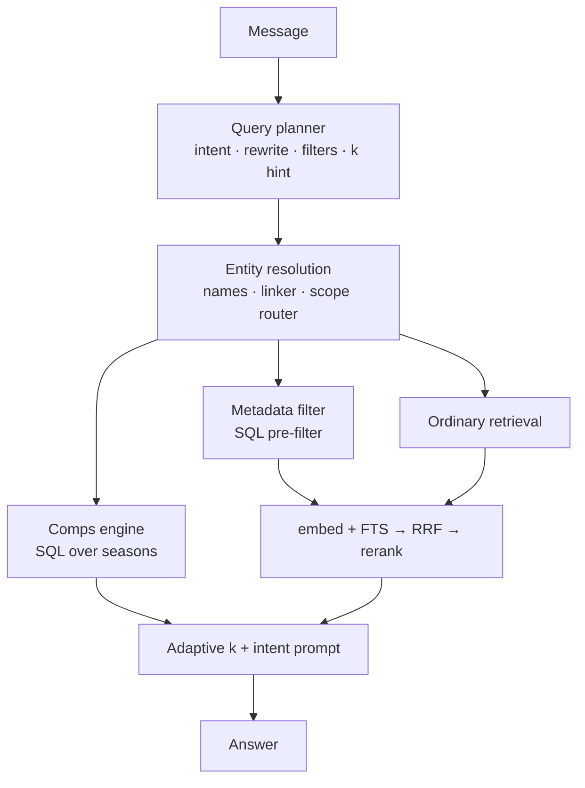

# Retrieval and grounded answers

PuckAI Scout answers from a corpus of 7,643 grounded scouting reports I generated,
never from the model's own memory. This doc covers two layers that used to be one
pipeline: how I find and rank documents, and how a later rewrite sits a planner,
entity linker, and computed comparables in front of those retrievers so the answer
path can do things text search structurally cannot.

Every number below comes from the harnesses in
[how it was measured](../benchmarks/README.md). Both harnesses call the production
functions, so the benchmark cannot drift away from the served path.

---

## Before and after

The old path had no stage between the user's sentence and the retrievers. Raw text
went verbatim to the embedding, the tsquery, the reranker, and the prompt.
`FINAL_K` was hardcoded to 5.

I inserted four stages in front, and replaced the constant *k* with an adaptive one:

Failure on the planner always returns a plan byte-identical to the old behaviour.
A flag turns the planner off and reproduces it exactly, which is how I scored the
baseline below.

---

## The four stages

### 1. Query planner

One structured-output call on a small model chosen independently of whichever model
writes the answer. It produces intent, a pronoun-resolved rewrite, named players,
club/league scope, measurable filters, and a *k* hint.

It never invents an id. It proposes name strings; the corpus's own index resolves
them. A hallucinated name matches nothing rather than the wrong player.

### 2. Entity linking

The resolver used to return nothing for any name matching several players, so
"Crosby, McDavid, and Mackinnon" pinned two and silently dropped the third. It now
reports ambiguous spans, and the linker settles them from NHL games played,
report-embedding similarity to the players who did resolve, and draft-cohort
proximity. All three signals are already in the database — no extra API call.

Scope routing still sits here as the club/league resolver it always was; it hands
`restrict_ids` / `pinned_ids` into the legs below.

### 3. Comparables computed, not retrieved

Text search cannot answer "who produced like X". The report that most resembles a
report about Cole O'Hara is a report about Ryan O'Hara — same surname token, wrong
task.

The comparison lives in `prospect_seasons`: anchor on the player's best pre-NHL
season by NHLe, candidates within an age window in the same league or tier group,
ranked by z-scored distance. Style comps reuse the anchor's own stored vector.
That path bypasses embed/FTS entirely and feeds adaptive *k* directly.

### 4. Metadata pre-filter

Height, weight, draft round, nation, PPG are columns, not semantics. The planner
extracts them; this stage turns them into `restrict_ids` — the same lever scope
routing already used — before hybrid retrieval runs.

### Supporting changes on the answer path

- Chat orchestration split into a pure decide-the-answer step (writes nothing, bills
  nobody) and a thin wrapper for quota, persistence, and response.
- Adaptive *k* replaces the constant 5.
- Entity masking on the lexical leg so pinned names do not drown the rest of the
  query.
- Intent-conditioned prompt; `PROMPT_VERSION` and intent added to the answer-cache
  key.
- Per-turn retrieval telemetry stored as JSONB for later diagnosis.

The unit tests covering planner, linker, comps, metadata filter, and the
decide-the-answer path brought the suite from 125 to 181.

---

## Why hybrid, and why both legs stay load-bearing

I tried dense-only and lexical-only first. They fail in opposite directions, and not
subtly:

| Class | Example | Dense | Lexical |
|---|---|---|---|
| Archetype | "physical two-way D with a heavy shot" | Wins — shared meaning, almost no shared keywords | Near-total failure |
| Name | "Macklin Celebrini" | Smears across similar-sounding prospects | Wins — exact match is the whole task |

Measured: on archetypes, keyword-only NDCG@10 is 0.051 against vector-only's 0.139.
On names, keyword-only is a clean 1.000 against vector-only's 0.954.

That is why I report eval metrics per class. A single average lets a configuration
that destroys one class hide behind another — and during development one nearly did.

### Weighted RRF, not score blending

Cosine distance and `ts_rank_cd` live on unrelated scales, so blending them
numerically means inventing a conversion. RRF fuses on **rank** and sidesteps it.

Equal weights actively hurt. Dense beats lexical ~2–3× on archetypes while both
legs already saturate name recall, so 50/50 dragged hybrid *below* vector alone.
Production is dense 2.0, lexical 1.0 — flat across a 2.0–5.0 sweep, which is the
shape you want: the result is not balanced on a knife edge.

### The lexical floor

Weighting dense at 2.0 created its own bug. On a query naming two players, the
second name could get pushed past the rerank pool boundary and never reach the
cross-encoder. I added a floor that reserves pool slots for the top lexical hits.
multi_name Recall@5: 0.833 → 1.000.

---

## Small-to-big: retrieve short, generate long

My retrieval unit is a compact field — one-line header plus the report prose.
Generation unit is the full dossier: bio, projection, report, season tables,
percentiles, assembled at request time for the final *k* only.

**Stat tables are not embedded.** Every player's table looks alike, so embedding
them pulls vectors toward a shared box-score centroid, inflates rerank cost, and
would force a re-embed after every prospect re-import. The tables reach the model
through hydration, where they cost nothing at ranking time.

### The header experiment, reverted

I enlarged the embedded header — physical frame plus a three-season summary — and
measured it rather than arguing about it:

| Metric | Before | After |
|---|---:|---:|
| NDCG@10, hybrid + rerank | 0.624 | 0.631 |
| MRR@10 | flat | flat |
| Recall@5 / P@5 | — | fractionally down |
| Attribute probes | — | worse |

Old and new vectors sat ~0.0145 cosine apart on average: the prose, ~1k chars,
dominated. I reverted it. **Do not retry.**

**Numeric and club constraints are a metadata-filter problem, not an embedding
problem.** Trying to make an embedding carry a hard constraint is a category error.
It is what motivated scope routing, and later the planner's filter extraction.

---

## Scope routing

"Top prospects at UMass over the last three seasons" was close to unanswerable by
text search, structurally. Club lives only in the header — ~5% of the doc.
`report_tsv` indexes the prose alone. And the header carries `latest_team`, where
the player is *now*, not where he was that season. The old behaviour returned
UMass-**Lowell** players and alumni who had left years earlier.

I built a deterministic router — **no LLM for the route itself** — that resolves
club or league from a DB-built alias index, hands `restrict_ids` into both SQL
legs, and takes `pinned_ids` from the *same* percentile ranking the team pages use,
so chat and board never disagree. It now sits inside entity resolution, after the
planner has proposed scope strings.

Four safeguards, each from an observed failure:

- **Tiered aliases** — an exact club name beats a place-name fragment.
- **Directory leagues only** — peewee clubs were claiming words like "center".
- **A group or superlative cue required** ("top", "best", "who are") so a
  head-to-head comparison that names a league is not over-scoped into a ranking.
- **Ambiguity → no route**, falling back to ordinary hybrid. A wrong scope is far
  worse than no scope.

Routed turns are **not cached**: the season window is invisible to the answer cache
key, so caching them returns confidently wrong answers.

Measured: team NDCG@10 0.376 → **1.000**, league 0.307 → **1.000**, with name,
multi_name, and archetype unchanged to three decimals.

---

## Lexical details that mattered

**Two configurations, not one.** `report_tsv` on `english` for prose, `name_tsv` on
`simple`, unstemmed, for names. Merging fails both ways: one config stems surnames
(`Louis` → `loui`), and OR-ing both into one tsquery explodes nodes — ~952 ms vs
~134 ms. Names score separately with `FTS_NAME_BOOST=3.0`.
See [ADR 0003](../decisions/0003-separate-name-and-prose-text-vectors.md).

**`&` rewritten to `|`.** `websearch_to_tsquery` ANDs every term, which drove
archetype recall to ~0 — no document contains all of a long question's words.
Rewriting to OR made the lexical leg usable again.

**`hnsw.ef_search = 400` per query.** The default 40 sits near `CANDIDATES_PER_LEG`
(30) and costs dense recall whenever the index path is used. At this corpus size
Postgres often seq-scans anyway; the setting is insurance for when it does not.

---

## Timeline

| Change | Problem | Result |
|---|---|---|
| Hybrid + rerank | Single-leg failure modes | Baseline NDCG@10 ~0.58 |
| Dense weight 2.0 | Unweighted hybrid scored below vector alone on archetypes | Hybrid beats both legs |
| FTS `&` → `\|` | Archetype lexical recall ~0 | Lexical usable again |
| Separate `name_tsv` + boost | Stemmed surnames; long queries drowned name weight | multi_name Recall@5 0.833 → 1.000 |
| `LEXICAL_FLOOR` | Dense weighting buried the second named player | Multi-entity queries reach the reranker |
| Header enlargement | Tried to carry club/attribute signal in the embedding | **Reverted** — noise and cost, no gain |
| Scope routing | Club/league is not a text-search problem | Team and league NDCG@10 → 1.000 |
| `ef_search=400` | Index path silently worse than exact | Dense near exact when HNSW is used |
| Planner + entity linker + comps + metadata filter | Raw text and fixed *k* could not do comps, filters, or follow-ups | Answer-check pass 0.51 → 0.85; ranking NDCG flat |

---

## Answer evaluation

Retrieval NDCG tells me whether the right documents are near the top. It does not
tell me whether the chat answered the question. I added a second harness over the
production decide-the-answer path.

### Dataset

119 questions over 12 intents, built from the database, with hand-written rows for
classes SQL cannot invent (follow-ups, off-topic, absent players).

| Intent | n | Intent | n |
|---|---:|---|---:|
| archetype | 20 | rank_team | 9 |
| lookup | 15 | style_comps | 8 |
| compare | 12 | constraint | 6 |
| stat_comps | 12 | off_topic | 6 |
| ambiguous_name | 11 | unknown_player | 6 |
| followup | 10 | rank_league | 4 |

Each row carries `must_include`, `must_not_include`, `expected_k`, `expect_refusal`,
`facts` (SQL-pulled values a judge can check), and judge notes.

**No label comes from keyword-matching the corpus or from asking the retriever under
test.** Distractors come from name-token overlap on the corpus name column;
constraint membership from SQL predicates; ambiguity labels from NHL games played;
archetype labels from structured playstyle tags on the player record. That is what
stops the benchmark scoring the system against its own opinion.

### Two layers

**Deterministic checks**, free on every case, no LLM: recall of the players the
question is about; whether the answer discussed a namesake; whether every number and
every capitalised name traces to that turn's own context; refusal correctness;
whether *k* fits the question. The numeric trace is ported from the existing report
validator, so a claim that traces in one place traces in both.

**LLM judge**, through a batch-and-ledger loop with no live API in the runner —
rubric mode once for a baseline, pairwise for every change after, because absolute
scores drift between sessions and a preference between two concrete answers does
not. A/B order is randomised per case and the mapping is kept out of the prompt.

The runner calls the production decide-the-answer path, so the benchmark cannot
drift from what users get, and records the exact context string sent to the model —
that is what makes offline faithfulness checkable. Rescoring recomputes a summary
from saved cases, so improving a check never costs another round of completions.

### Metrics

Baseline is the planner flag off — the genuine pre-change system — scored with
identical checks.

| Slice | n | Before | After |
|---|---:|---:|---:|
| lookup | 15 | 0.00 | 0.73 |
| compare | 12 | 0.00 | 0.83 |
| followup | 10 | 0.00 | 0.80 |
| unknown_player | 6 | 0.33 | 1.00 |
| ambiguous_name | 11 | 0.36 | 0.82 |
| style_comps | 8 | 0.62 | 0.75 |
| constraint | 6 | 0.83 | 1.00 |
| archetype | 20 | 0.85 | 1.00 |
| stat_comps | 12 | 0.92 | 0.75 |
| rank_team | 9 | 1.00 | 0.89 |
| **overall** | **119** | **0.51** | **0.85** |

Answers discussing a namesake: 18 → about 1. Mean *k* was 5.00 in every category;
it is now 1.07 for lookups, 2.00 for comparisons, 8.00 for league rankings.
Follow-up recall went 0.000 → 1.000.

Two honest caveats. **stat_comps** reads as a regression and is not: the baseline
scored 0.92 while returning useless namesake comps, because mechanical checks
measure faults, not usefulness. And only 5 of 119 pairwise judgements have been
run — enough to prove the loop and to catch the baseline reversing a player's goals
and assists on a case both number checks passed, but not a full sweep.

Retrieval ranking was re-measured as a no-regression check and is unchanged:
NDCG@10 0.682 → 0.684 on 78 queries.

---

## Ranking results

77 labelled queries — 30 name, 29 archetype, 8 team, 6 multi_name, 4 league — at
depth 10, against a corpus snapshot of 7,406 reports. Label construction and its
limits: [how it was measured](../benchmarks/README.md). No label is ever produced by
keyword-matching the reports or by the retriever under test.

### Overall

| Retrieval | Recall@5 | Recall@10 | P@5 | MRR@10 | NDCG@10 |
|---|---:|---:|---:|---:|---:|
| Keyword only (BM25-style FTS) | 0.465 | 0.468 | 0.140 | 0.555 | 0.488 |
| Vector only (pgvector) | 0.446 | 0.459 | 0.182 | 0.619 | 0.508 |
| Hybrid (RRF fusion) | 0.452 | 0.461 | 0.177 | 0.640 | 0.522 |
| Hybrid + reranker | 0.490 | 0.499 | 0.239 | 0.720 | 0.582 |
| **+ scope routing** | **0.508** | **0.530** | **0.330** | **0.764** | **0.682** |

### Archetype (29)

| Retrieval | Recall@5 | Recall@10 | P@5 | MRR@10 | NDCG@10 |
|---|---:|---:|---:|---:|---:|
| Keyword only | 0.005 | 0.013 | 0.041 | 0.151 | 0.051 |
| Vector only | 0.025 | 0.038 | 0.145 | 0.318 | 0.139 |
| Hybrid (RRF) | 0.023 | 0.040 | 0.124 | 0.341 | 0.141 |
| Hybrid + reranker | **0.029** | **0.045** | **0.186** | **0.374** | **0.162** |
| + scope routing | 0.029 | 0.045 | 0.186 | 0.374 | 0.162 |

### Name (30)

| Retrieval | Recall@5 | Recall@10 | P@5 | MRR@10 | NDCG@10 |
|---|---:|---:|---:|---:|---:|
| Keyword only | **1.000** | **1.000** | 0.200 | **1.000** | **1.000** |
| Vector only | 0.967 | 0.967 | 0.193 | 0.950 | 0.954 |
| Hybrid (RRF) | 0.967 | 0.967 | 0.193 | 0.967 | 0.967 |
| Hybrid + reranker | **1.000** | **1.000** | 0.200 | **1.000** | **1.000** |
| + scope routing | **1.000** | **1.000** | 0.200 | **1.000** | **1.000** |

### Multi_name (6)

| Retrieval | Recall@5 | Recall@10 | P@5 | MRR@10 | NDCG@10 |
|---|---:|---:|---:|---:|---:|
| Keyword only | 0.917 | 0.917 | 0.367 | 0.889 | 0.830 |
| Vector only | 0.667 | 0.750 | 0.267 | 0.792 | 0.669 |
| Hybrid (RRF) | 0.750 | 0.750 | 0.300 | 0.875 | 0.735 |
| Hybrid + reranker | **1.000** | **1.000** | **0.400** | **1.000** | **0.975** |
| + scope routing | **1.000** | **1.000** | **0.400** | **1.000** | **0.975** |

### Team (8)

| Retrieval | Recall@5 | Recall@10 | P@5 | MRR@10 | NDCG@10 |
|---|---:|---:|---:|---:|---:|
| Keyword only | 0.011 | 0.015 | 0.075 | 0.188 | 0.060 |
| Vector only | 0.069 | 0.086 | 0.200 | 0.481 | 0.211 |
| Hybrid (RRF) | 0.067 | 0.093 | 0.175 | 0.377 | 0.218 |
| Hybrid + reranker | 0.105 | 0.122 | 0.425 | 0.760 | 0.376 |
| **+ scope routing** | **0.255** | **0.384** | **0.950** | **1.000** | **1.000** |

### League (4)

| Retrieval | Recall@5 | Recall@10 | P@5 | MRR@10 | NDCG@10 |
|---|---:|---:|---:|---:|---:|
| Keyword only | 0.017 | 0.021 | 0.200 | 0.375 | 0.154 |
| Vector only | 0.015 | 0.023 | 0.200 | 0.342 | 0.194 |
| Hybrid (RRF) | 0.020 | 0.023 | 0.250 | 0.542 | 0.233 |
| Hybrid + reranker | 0.020 | 0.031 | 0.300 | 0.625 | 0.307 |
| **+ scope routing** | **0.056** | **0.113** | **1.000** | **1.000** | **1.000** |

### Reading these honestly

**Recall@K is bounded by K/|R|** when a query has more relevant docs than K. Normal
for archetype, extreme for league — a whole NCAA season is ~500 documents, hence a
league Recall@10 of 0.113 sitting next to a perfect NDCG. The ceiling applies
equally to every configuration, so the ranking between rows is unaffected.

**P@5 has the opposite ceiling.** A scope holding fewer than 5 documents cannot
reach 1.000 however perfect the retrieval. That is the whole of the team class's
0.950 — one club in the set has 3 reports in the corpus.

**NDCG@10 normalises per query**, which makes it the fairest single comparison and
the reason it is the headline for ranking. Answer-check pass rate is the headline
for the chat path.

---

## Related

- [How it was measured](../benchmarks/README.md) — how both query sets are built
- [Validator](../validation/README.md) — what makes the corpus trustworthy
- ADRs [0001](../decisions/0001-hybrid-retrieval.md) · [0002](../decisions/0002-weighted-rrf.md) · [0003](../decisions/0003-separate-name-and-prose-text-vectors.md)
