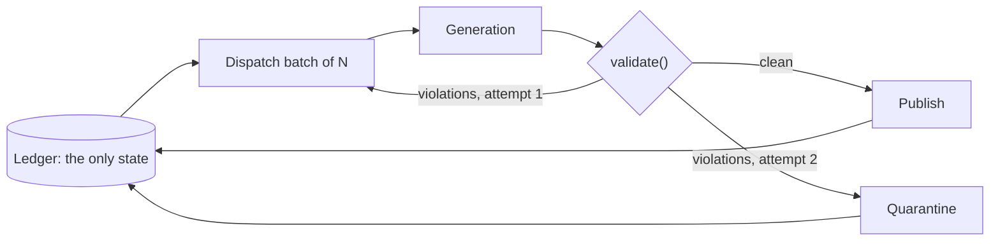

# The report validator

I generate 7,643 scouting reports as prose, sitting next to real projections on a
real site. Every factual claim in them has to trace back to a pipeline value. The
validator is what I built to enforce that.

**No LLM.** Every check is a mechanical trace from a claim in the report back to
the player's context JSON.

---

## Why it exists

I tried grounding rules *in the prompt* first, across three generation rounds on a
5-player sample. They did not hold. The model invented an age ("age 40"), a trophy
count ("second Norris"), a national ranking ("fourth nationally"), and banned
tracking-data vocabulary ("gap control"), all of it against explicit instructions
not to.

The verification pass caught them. So I put verification in the pipeline, not in a
manual review step that does not scale to seven thousand documents.

That is the general lesson I took from it: a prompt is a request, a checker is a
guarantee. They are not substitutes.

---

## Generation as a gated loop

The ledger is the entire state of a run. A batch that never returns (say the session
limit hits mid-flight) stays pending and gets picked up next cycle. No queue, no lock, no
partial-write recovery: resume is re-reading the ledger.

One regeneration per report. A second failure quarantines the report. It is never published.

---

## The checks

Each one exists because of a specific fabrication I caught.

### 1. Numbers

Every numeric literal must trace to a context value, or to a **legal derivation** of
one. The derivation set is explicit, not a loose tolerance:

| Derivation | Example |
|---|---|
| Rounding to 1 or 2 decimals | 1.088 licenses "1.09" |
| Truncation | 55.2 licenses "over 55 percent" |
| Probability → percent | 0.62 licenses "62 percent" |
| Decimal minutes → mm:ss | 24.683 licenses "24:41" |
| Prose-rounding tolerance | max(0.011 absolute, 0.5% relative) |

Comma-grouped thousands are normalised on both sides first, so "1,082" is checked as
1082, not as the fragments "1" and "082", which would otherwise match by chance
almost every time. Small integers (0–3) are skipped as ordinary prose counters.

### 2. Proper nouns

Capitalised terms outside a hockey-vocabulary allowlist must appear in the context.
Catches invented trophies, teams, rankings.

Two refinements were needed. A lone capitalised word that merely starts a sentence
is grammar, not a name. And a multi-token name must match as a **phrase**, with a
per-token fallback only for single tokens. Otherwise "second Norris" passes because
each of its words exists somewhere in the context.

### 3. Ordinal phrases

A distinct fabrication class, invisible to the proper-noun check: the ordinal itself
is lowercase even when the *count* is invented.

The bare word is useless to check. "fourth" appears in a bio as "fourth round",
which would license "ranked fourth nationally". So I check the ordinal as a
phrase with the word it modifies, and only when it is a real count claim: an ordinal
naming something specific ("second Norris") or a ranking ("fourth nationally").
Ordinary English like "his first full season" is not a factual count and is not
checked. Word form and digit forms both accepted.

### 4. Banned vocabulary

Zone, technique, shot-type, skating, and physical-play words are allowed **only** if
they appear in that player's own sourced scouting description on the bio. I hold no tracking data,
so anything else is invention however plausible it reads.

Roughly: slot, half wall, blue line, net-front · toe drag, no-look, saucer ·
one-timer, tip-in, wrister · edges, first step, gap control · puck battle, wingspan.

### 5. Age

An age claim must match the computed `age_by_season`, **scoped to the season it is
attached to**. "At just 18 years old… during 2025-26" was wrong even though 18
appears in the context, for a different season.

### 6. Awards and medals

Presence is not enough, and this check exists because of one specific failure. A
player's bio contained "silver" (a World Championship) and, in a *different
sentence*, the Olympics. The model welded them together and awarded his country an
Olympic silver it never won. Every token traced. The claim was still false.

So an award term must co-occur with its event **inside one context sentence**,
anchored by the event words and years in that sentence.

---

## False positives were the hard part

A validator that fires on correct reports is worse than none, because it teaches the
generator to delete true statements to satisfy the checker. Every narrowing is
recorded at the rule.

| Rule | Failure | Fix |
|---|---|---|
| Banned vocab | Substring matching fired "edges" inside *acknowledges*, "stride" inside *strident* | Whole-word match only |
| Banned vocab | "reach" is an ordinary verb ("reach the NHL") and flagged nearly every report | Dropped from the list |
| Age | The pattern read "23.6 years old" as an age claim of **6** | Capture the number with its decimal |
| Event words | "olympics" never matched a context saying "Olympic Winter Games", failing a report whose medal was real | Singular stems only, which match either form |
| Ordinals | The bare word licensed inventions and flagged ordinary prose | Phrase-level, restricted to real count claims |
| Numbers | A missing CSV field arrives as NaN and is not a citable value | Non-finite values excluded from the pool |

---

## Results

Full corpus, 953 batches, 2026-07-31 → 2026-08-23:

| | |
|---|---:|
| Attempts | 7,670 |
| Passed | 7,643 |
| Rejected, regenerated | 27 (0.35%) |
| Quarantined after retry | 0 |
| Published first try | 7,616 (99.6%) |

I generate the corpus in priority order so a run that does not finish still
produces the most valuable reports first: players with playstyle tags (1,649),
then NHL-bio players (677), then the rest (5,317).

**0.35% is not evidence the validator was unnecessary.** It is the rate *after* the
prompt was shaped by what earlier validator rounds caught. The pre-validator sample
rate was far higher, and every original check exists because of a fabrication a
prompt rule had already failed to stop.

---

## Known limits

I state these plainly, because a checker whose limits are undocumented gets trusted
past where it works.

**The number check is a presence check, not a semantic one.** A value that appears
anywhere in the context passes anywhere in the report, so a draft year reused as a
games-played total would not be caught. Catching that needs field-aware parsing. My
backstop is a 2% LLM spot-audit on published reports, which is a sample, not a
guarantee. The same presence check now also guards the Scout Agent's web answers, and
there I added a semantic LLM check on top of it for exactly this gap
([Scout Agent](../agent/README.md#5-two-layers-of-fact-check-on-web-answers)).

**The proper-noun allowlist is hand-maintained.** A new legitimately capitalised
hockey term is a false positive until I add it.

**Nothing checks whether a true statement is a useful one.** The validator confirms
claims are grounded. It has no opinion on whether a report says anything worth
reading.

---

## Related

- [Retrieval](../retrieval/README.md): what gets done with the validated corpus
- [ADR 0005](../decisions/0005-deterministic-validator-over-llm-judge.md): why not an LLM judge
- [How it was measured](../benchmarks/README.md)
